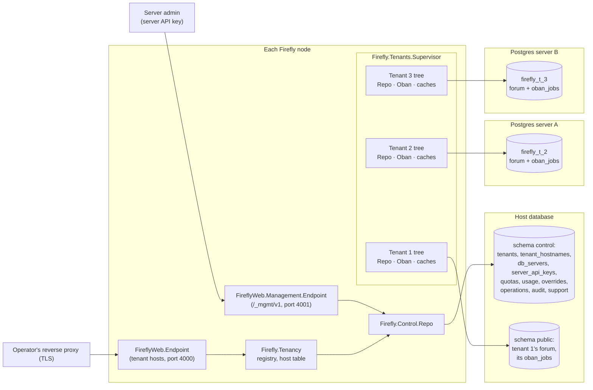
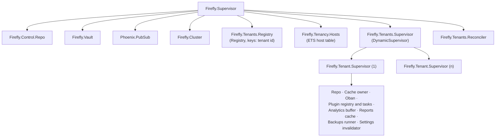

# Multi-tenancy: one server, many forums

Status: **design, for review; implementation started.** Section 11 plans the
stack of pull requests that implements it; PR 1 (the vault) and PR 2 (the
`control` schema and tenant registry) are open as drafts.

This document turns Firefly from a single forum per deployment into a server
that hosts many forums ("tenants"). It records the decisions already made,
recommends answers to the ones still open, and names the modules, tables,
processes and configuration keys the implementation will add or change.

**Revision 2** replaces the first draft's process and data model (one
global Oban on a separate control database, lazily started tenant pools) with
the one the user chose: **a duplicated supervision tree per tenant, each with
its own dynamic `Firefly.Repo` instance and its own Oban**, tenant database
URIs stored encrypted in the **host database**, which also holds the control
tables and is **tenant #1**. Sections 1, 2, 7, 8, 9.1, 10.3 and 11 are
rewritten; the others are updated where the new model touches them.

## Decisions already made (binding)

1. **Isolation: one PostgreSQL database per tenant.** Each tenant has a
   stored database URI, encrypted at rest; `Firefly.Repo` is used as a
   dynamic repo, switched per process to the tenant's instance. Tenant
   databases get the forum migrations only.
2. **A duplicated supervision tree per tenant** (`Firefly.Tenant.Supervisor`
   under `Firefly.Tenants.Supervisor`), holding the tenant's repo instance,
   its Oban instance and the per-tenant caches and processes that are global
   today. Trees **start at boot for every active tenant on every node**,
   start on provision, stop on suspend or delete, and restart on resume.
3. **The host database** holds the control tables (tenants, hostnames,
   encrypted database URIs, server API keys, quotas, audit log...) in a
   separate Postgres schema, **`control`**, with its own migrations. Tenant
   #1's forum data stays where it is today, in the host database's `public`
   schema: **the host database is tenant #1 by default**, with no data move.
4. **Oban runs per tenant**: each tenant's tree runs its own Oban instance
   against the tenant's database (through the dynamic repo), with its own
   cron. Jobs live with the tenant's data, so export and import carry
   pending jobs.
5. **Cloak (`cloak_ecto`, `Firefly.Vault`) is the default encryption at
   rest**, for everything: tenant database URIs, AI provider keys, TOTP
   secrets, secret site settings, plugin secrets, per-tenant mail
   credentials and every other secret column.
6. **Routing by hostname.** Each tenant has one or more hostnames: a
   subdomain of a base domain, plus optional custom domains, registered
   through the management API. TLS for custom domains is the operator's
   reverse proxy's job.
7. **Users are per tenant.** The same email on two forums is two accounts.
8. **Management API v1** covers the tenant lifecycle (create, list, update,
   suspend, resume, delete, hostnames, first-admin invite), server API keys
   (scoped; create, rotate, revoke; the first one bootstrapped by a release
   command or an environment variable), per-tenant settings overrides and
   quotas (storage, members, AI usage, rate limits), and tenant export and
   import (data plus uploads) to move a tenant between clusters.
9. **Mail credentials are per tenant** (3.5).
10. **Kaffy is always on in multi-tenant mode, scoped to the tenant's own
    data** (4.14).
11. **Support sessions need no tenant approval, and server admins can
    always see tenant activity** (5.3).
12. **No backwards compatibility.** Firefly is evergreen: nothing is
    deployed and there is no existing data to protect. So there is no
    `legacy` flag, no adopt/unadopt commands, no legacy upload paths, token
    salts, cookies or reply-address forms, no data migrations and no
    upgrade or rollback runbooks. Migrations only create or alter schema,
    and existing migrations are edited so the schema is right from the
    start. Sections that existed only for compatibility in revision 1
    (adopting an existing install, legacy behaviours, the switch-over
    runbook) are removed.

## What the design assumes about work in flight

| Work | State | What is assumed |
| --- | --- | --- |
| #111 Swoosh mail | Draft, at the bottom of the Oban stack | Merged before this stack. `Firefly.Mailer` wraps Swoosh with `FIREFLY_MAIL_ADAPTER` (smtp, ses, sendgrid, mailgun, postmark) |
| #114, #116, #120, #122 Oban | Drafts, green, stacked in that order: Oban with `Firefly.Jobs` and Oban Web at `/staff/jobs` (#114), cron through `Firefly.Jobs.Periodic` (#116), plugin events and webhook deliveries (#120), durable notification fan-out, emails, pushes and the former `Task.Supervisor` work (#122) | Merged before PR 7 of this stack. **This stack is based on #122**: PR 1 is stacked on it |
| libcluster (`libcluster_postgres`) | Merged (#118): `Firefly.Cluster`, configured from the repo's settings and `FIREFLY_CLUSTER*` | As on master |

Everything else referred to below (health and readiness, Prometheus,
OpenTelemetry, packages, Kaffy at `/staff/db`, typed site settings with
`FIREFLY_SETTING_*` pins, scoped API keys and the OpenAPI document, uploads,
backups, the MCP server) is on master.

## Summary of recommendations

* **The host database** has two Postgres schemas: `control` (the tenant
  registry and everything server-level, reached through a separate static
  repo, **`Firefly.Control.Repo`**) and `public` (tenant #1's forum data, as
  today). Tenant databases have only the forum schema.
* **`Firefly.Repo` stays the one forum repo module.** Each tenant's tree
  starts an instance of it under an atom name; processes select it with
  `put_dynamic_repo/1`. Its default dynamic repo is a name that is never
  started, so **a process without a tenant cannot query anything**.
* **Every tenant runs the same supervision tree**: repo, Oban (Postgres
  notifier on the tenant database, per-tenant cron), caches, plugin
  registry and task supervisor, analytics buffer, reports cache, backup
  runner. Starting, stopping and restarting a tenant is starting, stopping
  and restarting its tree. Tenant #1 is started the same way.
* **Globally**: the endpoints, PubSub (with tenant-prefixed topics),
  libcluster on the host database, HTTP client pools, telemetry, the vault,
  `Firefly.Control.Repo`, and the tenant registry with its host table.
* **Tenants are resolved by host** in the endpoint, before the session.
  Every signed artifact (session, tokens, reply addresses) is **bound to the
  tenant**.
* **Connections are the cost of this model**: every running tenant holds
  its pool and one `LISTEN` connection on every node. PgBouncer and small
  pools are required beyond a few dozen tenants (9.1).
* **Secrets are encrypted by `Firefly.Vault`** (Cloak, AES-256-GCM, tagged
  keys for rotation), in single- and multi-tenant mode alike.
* **Single-tenant mode stays the default** (`FIREFLY_MULTITENANT=false`):
  the host is the only tenant, and nothing else changes for self-hosters.

---

## 1. The host database and the tenant plane



### 1.1 The `control` schema and `Firefly.Control.Repo`

A top-level context, **`Firefly.Control`** (`apps/firefly/lib/firefly/control.ex`,
a `use Boundary` facade registered in `Firefly.BoundariesTest`), owns the
control plane.

**Recommendation: a separate repo module, `Firefly.Control.Repo`, on the
host database**, rather than `Firefly.Repo` with `prefix: "control"`:

* `Firefly.Repo` is the dynamic per-tenant repo and fails closed without a
  tenant. Control queries happen with no tenant (boot, the management API,
  the tenant reconciler) or with a different tenant selected (a support
  session check while serving tenant 7). A static repo of its own is never
  switched, so a control query can't land in a tenant database, and a tenant
  query can't reach the control schema through it.
* Its migrations are a separate set with their own version table
  (`control.schema_migrations`), so the forum migrations, which run on every
  tenant database, can never create control tables, and the control
  migrations run only where `Firefly.Control.Repo` points: the host.
* Its schemas declare `@schema_prefix "control"`. The cost is one more small
  pool on the host database (`FIREFLY_CONTROL_POOL_SIZE`, default 2).

Configuration: the host database is `FIREFLY_DATABASE_URL`, as today; both
`Firefly.Control.Repo` and tenant #1's `Firefly.Repo` instance connect to
it. Migrations live in `apps/firefly/priv/control_repo/migrations`, run with
`prefix: "control"` after `CREATE SCHEMA IF NOT EXISTS control`
(`Firefly.Control.Migrator`). It is started in both modes: single-tenant
mode reads tenant #1 from it at boot.

Tables (all in schema `control`):

| Table | Columns (main) | Purpose |
| --- | --- | --- |
| `tenants` | `id` bigint (1 is the host), `public_id` uuid (prefixes, signatures), `slug` unique, `name`, `status` (`provisioning`, `active`, `suspended`, `deleted`), `status_reason`, `suspended_message`, **`database_url` (bytea, `Firefly.Encrypted.Binary`; null only for tenant 1, meaning "the host connection")**, `db_server_id`, `pool_size`, `oban_queues` jsonb (per-tenant queue limits), `schema_version` bigint, `schema_status` (`current`, `pending`, `migrating`, `failed`), `schema_error`, `features` jsonb, `purge_after`, `deleted_at`, timestamps | One row per forum. PR 2 creates `id`, `slug`, `name`, `status`, `database_url`, `pool_size` and timestamps; later PRs add the rest |
| `tenant_hostnames` | `tenant_id`, `hostname` unique (lowercase ASCII), `primary` boolean (one per tenant), `kind` (`subdomain`, `custom`), `verification_token`, `verified_at` | Host routing |
| `db_servers` | `id`, `name`, `admin_url` (encrypted; a role with `CREATEDB CREATEROLE`), `tenant_url_template` (encrypted, e.g. through PgBouncer), `max_tenants`, `status` (`open`, `closed`, `draining`) | Where provisioning places new tenant databases (9.2) |
| `server_api_keys` | `id`, `name`, `prefix`, `token_hash`, `scopes` text[], `allowed_ips`, `expires_at`, `revoked_at`, `last_used_at`, `last_used_ip`, `created_by_key_id`, `rotated_from_id` | Management API auth |
| `tenant_quotas` | `tenant_id`, `storage_bytes`, `members`, `ai_requests_per_month`, `ai_tokens_per_month`, `requests_per_minute`, `plugin_calls_per_minute`, `live_sockets` (null: unlimited) | Limits |
| `tenant_usage` | `tenant_id`, `period`, `storage_bytes`, `members`, `ai_requests`, `ai_tokens`, `requests` | Counters for quotas (6.7) |
| `tenant_setting_overrides` | `tenant_id`, `key`, `value` jsonb, `secret_value` (encrypted, for secret settings), `locked`, `updated_by_key_id` | Server-imposed site settings (4.1) |
| `tenant_operations` | `id` uuid, `tenant_id`, `kind`, `status`, `step`, `progress`, `error`, `result`, `server_key_id` | Asynchronous work (6) |
| `mgmt_idempotency_keys`, `mgmt_audit_events`, `support_sessions`, `server_settings` | As in the first revision | Idempotent creates; append-only management audit; support access (5.3); server-level settings |

The `tenants` row of tenant 1 is created by the first control migration
(`id = 1`, slug `host`, status `active`, `database_url` null), so every
install, single or multi, has it from its first
`bin/migrate`. A check constraint allows a null `database_url` only on
tenant 1.

The tenant database keeps every table it has today. It gains nothing that
names a tenant: **no `tenant_id` column anywhere in tenant data**, which is
what makes export and import a plain dump and restore (6.8).

### 1.2 Oban per tenant

Each tenant tree starts its own Oban instance (2.2):

```elixir
{Oban,
 name: Firefly.Tenancy.oban_name(tenant),          # :"Firefly.Oban.T42"
 repo: Firefly.Repo,
 get_dynamic_repo: fn -> Firefly.Tenancy.repo_name(tenant) end,
 notifier: Oban.Notifiers.Postgres,                # LISTEN on the tenant DB
 peer: Oban.Peers.Database,                        # leader per tenant, in its oban_peers
 queues: Firefly.Tenancy.queues(tenant),           # FIREFLY_JOBS_* capped by tenants.oban_queues
 plugins: [{Oban.Plugins.Cron, crontab: Firefly.Jobs.crontab()},
           {Firefly.Jobs.Pruner, ...}, {Oban.Plugins.Lifeline, ...}]}
```

* **Jobs live in the tenant's database** (`oban_jobs` and `oban_peers` are
  forum migrations, as on #114), so inserting a job in the same transaction
  as the rows it refers to works as it does today, and exports carry
  pending jobs.
* **Each job runs with its tenant set.** `Firefly.Jobs.Worker`
  (`use Firefly.Jobs.Worker` in place of `use Oban.Worker`) defines
  `perform/1`, which maps `job.conf.name` to the tenant (a registry lookup),
  calls `Firefly.Tenancy.put/1` and then the module's `run/1`. Job args
  carry no tenant id: a job can only ever run in the instance, and so the
  database, it was inserted into.
* **Enqueueing** goes through `Firefly.Jobs.insert/1`, which calls
  `Oban.insert(Firefly.Tenancy.oban_name(), changeset)` for the current
  tenant and raises without one (fail-closed).
* **Cron**: each tenant's leader runs the crontab on its own data. The
  "every minute" entries from #116 (topic timers, bookmark reminders, poll
  closing, unused uploads, link previews, embeddings, plugin jobs) become 7
  jobs per tenant per minute; at 1,000 tenants that is 7,000 mostly empty
  jobs a minute. The due-time ones (timers, reminders, polls) should become
  exact `scheduled_at` jobs inserted when the timer is set (PR 7), leaving
  minute polling only where work arrives continuously.
* **Server work** (the daily version check) runs once per cluster, from
  tenant 1's Oban only (`Firefly.Tenancy.host?/1` in the crontab builder).
* `job_retention_days` stays a site setting: each tenant prunes its own
  jobs.
* **Fairness** is by construction: a busy tenant fills its own queues.
  Per-node concurrency per tenant comes from `FIREFLY_JOBS_<QUEUE>`
  (defaults lowered for multi-tenant mode, 9.1) and `tenants.oban_queues`.
* **Oban Web** (`/staff/jobs`) stays available to each tenant's admins,
  resolved to the request's tenant instance (`oban_name` from the conn): it
  can only see that tenant's database. A server-wide jobs overview is the
  management API's `GET /tenants/{id}/jobs` (5.3).

### 1.3 Where libcluster's channel lives

On the **host database**, as on master: `Firefly.Cluster` takes its
connection settings from `Firefly.Control.Repo`'s config (the host) and
listens on `FIREFLY_CLUSTER_NAME`'s channel. Every node reaches the host
database anyway. Its `LISTEN` connection, like the Oban notifiers', needs a
session, so it is never routed through PgBouncer in transaction mode.

Clustering matters more with tenants: tenant lifecycle changes (2.5) and
cache invalidation (4.1) travel over `Firefly.PubSub`. The reconciler also
re-reads the tenants table every 60 seconds as a backstop.

### 1.4 Where `/health` and `/ready` check

* `GET /health`: unchanged, no database, before tenant resolution.
* `GET /ready` checks the **host database** (`SELECT 1` on
  `Firefly.Control.Repo`), pending **control** migrations, pending forum
  migrations **on tenant 1**, and that the tenant reconciler has finished
  its boot pass (2.5). It does not check other tenant databases: one broken
  tenant must not take every node out of the load balancer. It reports a
  fleet summary: `tenants: %{running: 812, failed_to_start: 1,
  schema_pending: 0}`.
* Per-tenant health is `GET /_mgmt/v1/tenants/{id}/health` (6.3).
* Single-tenant mode keeps today's checks (tenant 1 is the forum).

---

## 2. Process model

### 2.1 One repo module, one instance per tenant

```elixir
# apps/firefly/lib/firefly/repo.ex (sketch)
defmodule Firefly.Repo do
  use Ecto.Repo,
    otp_app: :firefly,
    adapter: Ecto.Adapters.Postgres,
    # Never started: a process with no tenant set fails on its first query.
    default_dynamic_repo: Firefly.Repo.NoTenant

  use Scrivener, page_size: 10
end
```

* `default_dynamic_repo` is an existing `use Ecto.Repo` option. Because
  `Firefly.Repo.NoTenant` is never started, a query from a process that
  didn't select a tenant raises `could not lookup Ecto repo
  Firefly.Repo.NoTenant because it was not started or it does not exist`.
* **Names**: `Firefly.Tenancy.repo_name(tenant)` is `:"Firefly.Repo.T#{id}"`,
  tenant 1 included. One atom per tenant ever served by the node, far under
  the atom limit. Because the name, not a pid, is what a process selects, a
  LiveView that selected tenant 7 keeps working across a restart of tenant
  7's tree.
* **The URL**: tenant 1's instance uses the host connection
  (`FIREFLY_DATABASE_URL`, the `config :firefly, Firefly.Repo` settings);
  every other tenant's comes from `tenants.database_url`, decrypted by the
  vault when the tree starts, merged over the shared settings (SSL, IPv6,
  `prepare: :unnamed` behind PgBouncer) with `pool_size: tenant.pool_size`.

### 2.2 The supervision trees



**`Firefly.Tenants.Supervisor`** is a `DynamicSupervisor` (`one_for_one`,
generous `max_restarts`, so one tenant crashing repeatedly can't take the
others down: its tree's own restart intensity gives up first and the
reconciler marks it `failed_to_start`).

**`Firefly.Tenant.Supervisor`** is started per tenant with
`name: {:via, Registry, {Firefly.Tenants.Registry, tenant.id, runtime}}`,
where `runtime` is the tenant's `%Firefly.Tenancy.Runtime{}` (tenant struct,
repo name, Oban name, cache table ids), so one registry lookup gives a
process everything it needs. Its children, in order, `rest_for_one`
(everything after the repo depends on it):

| Child | Global today | Per tenant |
| --- | --- | --- |
| `{Firefly.Repo, name: repo_name, url: ..., pool_size: ...}` | `Firefly.Repo` in `Firefly.Application` | The tenant's pool |
| `Firefly.Tenant.Caches` (an ETS owner) | `:persistent_term` and named ETS tables | Unnamed ETS tables, one per kind (4.2), published in the registry value; they die with the tree, so stopping a tenant drops all its cached data at once |
| `Firefly.SiteSettings.Cache` | Node-wide, `:persistent_term`, `"site_settings"` topic | Subscribes to the tenant's `"t:<id>:site_settings"` topic and clears the tenant's settings table |
| `{Task.Supervisor, Firefly.Plugin.TaskSupervisor}` | One for the node | The tenant's plugin calls, so stopping a tenant kills its in-flight calls and a per-tenant concurrency cap is a supervisor limit |
| `Firefly.Plugins.Registry` | Loads every plugin at boot | Loads the tenant's plugins; the plugin health (circuit breaker) table and the transformed-post cache (`Firefly.Plugins.Content`) become tenant tables |
| OEmbed `LruCache` | `:oembed_cache`, 5,000 entries | Per tenant (`FIREFLY_TENANT_OEMBED_CACHE`, default 500), so a forum can't learn what another previewed |
| `Firefly.Analytics.Buffer` | One ETS buffer | The tenant's counts, flushed to its database |
| `Firefly.Reports.Cache` | One ETS table | The tenant's reports |
| `Firefly.Backups.Runner` | Also holds read-only mode in `:persistent_term` | The tenant's backups and restores; read-only mode in the tenant's cache table |
| `{Oban, ...}` (1.2) | One Oban on `Firefly.Repo` | Last, so jobs start only once everything they use is up |

Rate limits: `Firefly.RateLimit` is a Hammer ETS backend whose table is
named after the module, so it can't be duplicated as is. It stays one
process, with every key prefixed by the tenant (`Firefly.Tenancy.key/1`),
and the tree's termination deletes the tenant's buckets
(`:ets.match_delete`). Hammer's per-node semantics don't change.

Each child's `init/1` receives the tenant and calls `Firefly.Tenancy.put/1`,
so everything a tenant process does is in that tenant.

**Tenant 1 is started exactly the same way**, with the host connection. In
single-tenant mode it is the only child of `Firefly.Tenants.Supervisor`.

### 2.3 What stays global

| Process | Why |
| --- | --- |
| `FireflyWeb.Endpoint`, `FireflyWeb.Management.Endpoint` | One listener per port; tenants are resolved per request |
| `Firefly.PubSub` | One cluster-wide bus; topics are prefixed per tenant (4.6), server topics are `control:*` |
| `Firefly.Cluster` (libcluster) | One per node, on the host database (1.3) |
| HTTP clients: Req's default Finch pool, Swoosh's API client, hackney for plugins | Connection pools per remote host, not per tenant; tenants share outbound capacity, bounded by quotas (6.7) |
| `FireflyWeb.Telemetry`, the Prometheus reporter, OpenTelemetry | Node-level; tenant is a span attribute and log metadata (4.8, 4.9) |
| `Firefly.Control.Repo` | The host database's `control` schema |
| `Firefly.Vault` | One key set for the cluster (10.3) |
| `Firefly.Tenants.Registry`, `Firefly.Tenancy.Hosts`, `Firefly.Tenants.Supervisor`, `Firefly.Tenants.Reconciler` | The tenant registry and host table |
| `Firefly.RateLimit` | Keys prefixed by tenant (2.2) |
| `Firefly.Health.TaskSupervisor`, `FireflyWeb.Presence` (keys prefixed), `FireflyWeb.Draining`, `Firefly.Plugin.Sandbox`, `FireflyPlugins.Runtime`'s compiled engine | Node-level by nature |

### 2.4 How every process gets its tenant

`Firefly.Tenancy` (a top-level context) is the only API:

| Function | Does |
| --- | --- |
| `put(tenant)` | Looks the tenant's runtime up in the registry (raises if its tree isn't running), `Firefly.Repo.put_dynamic_repo(repo_name)`, stores the runtime in the process dictionary, sets `Logger.metadata(tenant: slug)` and the span attributes |
| `current()` / `current!()` | The tenant, or `nil` / raises `Firefly.Tenancy.NoTenantError` |
| `with_tenant(tenant_or_id, fun)` | Runs `fun` in the tenant, restoring the previous one afterwards |
| `async(fun)`, `start_child(sup, fun)`, `async_stream(...)` | `Task.Supervisor` wrappers that capture the caller's tenant and set it in the child; the default supervisor is the tenant's own |
| `context()` / `restore(context)` | Tenant plus OpenTelemetry context as one term (`Firefly.Telemetry.bind/1` carries it) |
| `topic(name)`, `key(term)`, `cache(kind)`, `oban_name()`, `repo_name()` | The tenant's PubSub topic, cache key, ETS table, Oban and repo names |

Where it is set:

| Process | How |
| --- | --- |
| HTTP request | `FireflyWeb.Plugs.Tenant` in `FireflyWeb.Endpoint` (3.1) calls `put/1` |
| LiveView | `on_mount FireflyWeb.TenantHook`, first in every `live_session`: resolves the tenant from `socket.host_uri`, checks it matches the session's tenant binding (3.3), calls `put/1`. A LiveView process keeps it for its life; when the tenant is suspended its tree stops and the hook's subscription to `"t:<id>:tenant"` disconnects the socket |
| Channels | `FireflyWeb.UserSocket.connect/3` resolves the tenant; `join/3` calls `put/1` |
| Oban jobs | `Firefly.Jobs.Worker.perform/1`, from the instance that runs the job (1.2) |
| Tenant tree processes | Their `init/1` (2.2) |
| `Task` children | `Firefly.Tenancy.async/1` and friends; `$callers` kept for the sandbox |
| PubSub handlers | Subscribers are tenant processes (LiveViews, channels, the tree's invalidators) that already have their tenant; they subscribe through `Firefly.Broadcast`, which prefixes the topic, so they only ever receive their own tenant's messages |
| Release commands, `mix` tasks, IEx | `Firefly.Tenancy.with_tenant("slug", fn -> ... end)`; `FireflyImport.CLI` takes `--tenant` (default: tenant 1); seeds run per tenant |

**Fail-closed everywhere.** No tenant means: the repo raises (2.1),
`Firefly.Jobs.insert/1` raises, `topic/1`, `key/1`, `cache/1`,
`Firefly.Endpoint.url/0`, `Firefly.Uploads.Storage` and `Firefly.RateLimit`
raise `NoTenantError`. Nothing falls back to tenant 1, in either mode. Two
static checks keep it that way: a Credo check
(`Firefly.Credo.TenantlessSpawn`) flags `Task.*`, `spawn` and direct
`Phoenix.PubSub` calls outside `Firefly.Tenancy`, `Firefly.Broadcast` and an
allowlist; a test lists every `:persistent_term.put` and named `:ets.new`
call and fails on unreviewed ones.

### 2.5 Starting and stopping trees

`Firefly.Tenants.Reconciler` (a GenServer, one per node) owns the set of
running trees:

* **At boot** it loads every tenant with status `active` from
  `Firefly.Control.Repo`, starts tenant 1 first and waits for it, then the
  others with `Task.async_stream(max_concurrency:
  FIREFLY_TENANT_START_CONCURRENCY (default 10))`, so a node with 1,000
  tenants doesn't open 4,000 connections in the same second. A tree that
  fails to start (database unreachable, wrong credentials, schema behind)
  is logged, counted in `/ready`'s summary, retried with backoff (30 s,
  doubling to 10 min), and doesn't block the others. The endpoint starts
  serving once tenant 1 is up; requests for a tenant whose tree isn't
  running yet get `503` with `Retry-After: 5`.
* **On a lifecycle change** (provision finished, suspend, resume, delete,
  pool size or URL changed), `Firefly.Control` broadcasts `{:tenant_changed,
  id}` on `"control:tenants"` after commit; every node's reconciler re-reads
  that tenant and starts, stops or restarts its tree. Suspend and delete
  stop it (in-flight jobs are cancelled by Oban's shutdown grace period,
  `FIREFLY_TENANT_SHUTDOWN_MS`, default 15 s, and retried on resume);
  resume starts it.
* **Backstop**: every 60 s the reconciler diffs the tenants table against
  the running trees, so a node that missed a broadcast converges.

### 2.6 Tests

* `config/test.exs` keeps one test database for the host (`public` is
  tenant 1, `control` the registry) and adds a second tenant database,
  `firefly_test_t2<partition>`, migrated by the `mix test` alias. Both
  tenant repos start statically under their tenant names with
  `pool: Ecto.Adapters.SQL.Sandbox`.
* `Firefly.DataCase` and `FireflyWeb.ConnCase` check out tenant 1's repo and
  `Firefly.Control.Repo` and call `Firefly.Tenancy.put(tenant_1)`, so **the
  existing suite runs under tenancy** and exercises fail-closed paths
  unchanged. Oban in tests: each tenant's instance with `testing: :manual`;
  `Oban.Testing` helpers take the tenant's Oban name.
* `Firefly.MultiTenantCase` checks out both tenants and gives
  `in_tenant(t, fun)` helpers and fixtures.
* e2e: `Phoenix.Ecto.SQL.Sandbox.metadata_for/2` takes both repo names;
  browsers visit `http://t1.localhost:4002` and `http://t2.localhost:4002`.

---

## 3. Tenant resolution

### 3.1 Host lookup in the endpoint

`FireflyWeb.Plugs.Tenant` goes into `FireflyWeb.Endpoint` after
`FireflyWeb.ClientIP` and before `Plug.Session`:

```elixir
plug(FireflyWeb.Plugs.Health)      # tenantless
plug(FireflyWeb.Metrics)           # tenantless
plug(Plug.Static, ...)             # shared assets, tenantless
plug(FireflyWeb.ClientIP)
plug(FireflyWeb.Plugs.Tenant)      # new
plug(Plug.RequestId)
...
plug(Plug.Session, ...)
plug(FireflyWeb.Router)
```

* **Normalising**: lowercase, strip the port and a trailing dot, IDNA to
  ASCII. `X-Forwarded-Host` only from trusted proxies
  (`FIREFLY_TRUSTED_PROXIES`, as `FireflyWeb.ClientIP` decides).
* **Cache**: `Firefly.Tenancy.Hosts` owns the ETS table `hostname =>
  tenant_id`, loaded whole from `control.tenant_hostnames` at boot and kept
  fresh by `"control:tenants"` plus the reconciler's 60 s pass. An unknown
  host never reaches a database.
* **Unknown host**: `404`, static page, no session cookie.
* **The server host** (`FIREFLY_SERVER_HOST`) is not a tenant: only
  `/inbound/*` (3.6) is served there.
* **Status**: `suspended` gives `503` with the tenant's message (problem+JSON
  for `/api/*`); `provisioning`, a tree not running, or a schema behind give
  `503` "being set up / under maintenance" with `Retry-After: 60`;
  `deleted` gives `404`, the host staying reserved until purge.
* It then calls `Firefly.Tenancy.put/1`, `put_router_url(conn, tenant.url)`
  (3.4), and stores `conn.private.firefly_tenant`.
* **Single-tenant mode**: tenant 1 serves every host, as today.

### 3.2 Cookies and session scope

* The session cookie has no `Domain` attribute (per host); that stays.
* **Cookie tossing**: a page on `evil.forums.example` can set
  `Domain=forums.example` cookies sent to every sibling. In multi-tenant
  mode the session cookie is **`__Host-firefly_session`**, which browsers
  refuse to accept with a `Domain`. Plug.Session's options become runtime
  config read by a small `FireflyWeb.Session.Plug` wrapper. Dev uses
  `firefly_session`.
* Operators with untrusted tenants should put the base domain on the
  Public Suffix List (open question 8).

### 3.3 Binding the session to the tenant

All tenants share one `secret_key_base`, so a signed cookie from tenant A
is valid on B, and user id 5 on A is someone else on B. The session stores
`"tenant"` (the tenant's `public_id`) next to `"current_user"`;
`FireflyWeb.Plugs.Tenant` (after the session is fetched) and
`FireflyWeb.TenantHook` drop a session whose tenant doesn't match the host's.
A per-tenant
`secret_key_base` was rejected: LiveView signs and reads with the
endpoint's configured secret.

### 3.4 CSRF, `check_origin`, URLs

* **CSRF**: the token is in the session, which is per host and bound.
* **`check_origin`**: `{Firefly.Tenancy.Hosts, :origin_allowed?, []}`
  allows hostnames of running tenants; the socket must then match the
  session's tenant (3.3).
* **URL generation**: `Firefly.Endpoint.url/0` returns
  `Firefly.Tenancy.current!().url` (the primary hostname). Everything the
  domain builds goes through `Firefly.URLs`. In the web app,
  `put_router_url/2` per request; the bare `url(~p"...")` and
  `FireflyWeb.Endpoint.url()` call sites move to the conn or socket form,
  and a test fails on new bare ones.
* Non-primary hostnames `301` to the primary unless marked `serve: true`.

### 3.5 Email links and outbound mail

* Links: through `Firefly.URLs`, per tenant. Mail jobs run in their
  tenant's Oban (1.2).
* Sender (**decided: mail credentials per tenant**): each tenant may set
  its own adapter and credentials (SMTP, SES, SendGrid, Mailgun, Postmark)
  as **secret site settings**, stored encrypted by the vault
  (`forums_site_settings.secret_value`, from PR 1), editable by tenant
  admins at `/staff/settings` and by the server through the management API.
  Never shown back, only replaced.
  * `Firefly.Mailer` builds the Swoosh config per send from the current
    tenant (`Swoosh.Mailer.deliver/2` takes a config).
  * Without its own adapter, a tenant uses the server's (env) with `From:
    "<tenant title>" <FIREFLY_EMAIL_FROM>`.
  * SMTP hosts and API endpoints go through the egress guard (4.4).
* `Firefly.Notifications.EmailLog` stays per tenant database.

### 3.6 Inbound email

Reply addresses become
`reply+<tenant public id, base32>.<thread>-<user>-<signature>@<FIREFLY_REPLY_EMAIL_DOMAIN>`,
with a signing key derived per tenant (10.4). `FireflyWeb.InboundController`
on the server host parses the tenant prefix and handles the rest inside
`with_tenant/2`.

### 3.7 Embeds, CORS, MCP

Per host, unchanged beyond tenant context: `/embed.js` and its
`frame-ancestors` come from the tenant's `embeddable_hosts`; `/api/v1` keys
are per tenant database; `/mcp` compares `Origin` with the tenant's
hostnames.

---

## 4. What is global today and must become per tenant

### 4.1 Site settings and their cache

* Today: `Firefly.SiteSettings` caches all values in `:persistent_term`,
  invalidated through the `"site_settings"` topic.
* Fix: the tenant's settings table (2.2), cleared by the tree's
  `Firefly.SiteSettings.Cache` on the tenant's topic. `:persistent_term` is
  wrong for per-tenant data: every update forces a global GC scan.
* **Precedence** (highest first): `FIREFLY_SETTING_<KEY>` pins with
  `pin_scope: :server`; `tenant_setting_overrides` with `locked: true`; the
  tenant admin's value; overrides with `locked: false`; the default. Pins
  with `pin_scope: :single` (titles, credentials) apply only to tenant 1.
  `scope: :server_only` hides a setting from tenant admins in multi-tenant
  mode (`enable_database_admin` is forced on instead, 4.14).

### 4.2 Caches that move into the tenant tree

| Cache today | Where | In the tree |
| --- | --- | --- |
| Custom emoji, `:persistent_term` | `Firefly.Rendering.Emoji` | Tenant table, loaded lazily |
| Watched words, `:persistent_term` | `Firefly.Moderation.WatchedWords` | Tenant table |
| Active plugins, `:persistent_term` | `Firefly.Plugins` (reloaded by `Plugins.Registry`) | Tenant table, loaded by the tenant's registry |
| Plugin stats and circuit breaker, named ETS | `Firefly.Plugins.Health` | Tenant table: a plugin tripping on one forum no longer trips it everywhere |
| Plugin-transformed posts, `LruCache` | `Firefly.Plugins.Content` | Tenant `LruCache` |
| Theme CSS, `:persistent_term` | `Firefly.Themes` | Tenant table (theme ids repeat across databases) |
| Reports, named ETS | `Firefly.Reports.Cache` | The tenant's process |
| OEmbed, `LruCache :oembed_cache` | `Firefly.Rendering.OEmbed` | Tenant `LruCache` |
| SAML metadata, OIDC discovery, `:persistent_term` | `Firefly.Accounts.Auth.SAML`, `.OIDC` | Tenant table (per-tenant providers, 4.11) |
| Apple client secret, `:persistent_term` | `Firefly.Accounts.Auth.AppleSecret` | Tenant table |
| Analytics daily salt, `:persistent_term` | `Firefly.Analytics` | Tenant table |
| Analytics counts, named ETS | `Firefly.Analytics.Buffer` | The tenant's process |
| Read-only mode, `:persistent_term` | `Firefly.Backups.Runner` | Tenant table, plus `tenants.status` |
| Rate-limit buckets, Hammer ETS | `Firefly.RateLimit` | Global table, tenant-prefixed keys, dropped with the tree (2.2) |
| Sandbox implementation, draining flag, QuickJS engine, OTel metrics ETS | `Firefly.Plugin.Sandbox`, `FireflyWeb.Draining`, `FireflyPlugins.Runtime`, `FireflyWeb.OpenTelemetry.Metrics` | Stay global: node-level |

`Firefly.Tenancy.cache(kind)` returns the current tenant's table for a
kind; the tables are created by `Firefly.Tenant.Caches` with
`read_concurrency`, and a per-kind size cap evicts the tenant's oldest
entries.

### 4.3 Themes and compiled CSS URLs

Resolved on the tenant's host; only the cache key changes (4.2).

### 4.4 The package registry: per tenant, with a server policy

Packages stay installed per tenant. The sandbox is already per call
(fresh wasm store, memory, fuel, deadline). Added: the per-tenant plugin
task supervisor caps concurrent calls (default 4 per node);
`plugin_calls_per_minute` (6.7); `tenants.features.plugins` (`none`,
`catalog` by default in multi-tenant mode, `any`) with a server catalog;
egress refuses the management listener, the host database and the
cluster's addresses.

### 4.5 Uploads

Content-addressed keys collide across tenants, and one tenant's cleanup
would delete another's file. `Firefly.Uploads.Storage` prefixes keys with
`t/<tenant public id>/`, tenant 1 included. Keys stored in the tenant
database don't change, so export and import don't rewrite rows. One bucket
with prefixes for v1 (open question 3).

### 4.6 PubSub topics

Thread 12 exists on every forum, so unprefixed topics would cross tenants.
`Firefly.Broadcast` (`subscribe/1`, `broadcast/3`, `broadcast_from/4`)
prefixes every topic with `"t:<id>:"` through `Firefly.Tenancy.topic/1`;
`Firefly.Endpoint.broadcast/3`, channel topics, Presence keys and
`live_socket_id` do too. Server topics are `"control:*"`. Credo forbids
direct `Phoenix.PubSub` calls.

### 4.7 Rate limits

Keys prefixed by tenant (2.2), so a brute force against `bob` on A doesn't
lock out `bob` on B; limits come from each tenant's settings.

### 4.8 Prometheus labels

No `tenant` label on existing metrics by default (cardinality). A few
per-tenant series behind `FIREFLY_METRICS_TENANT_LABELS=true`:
`firefly_tenant_requests_total`, `firefly_tenant_pool_checkout_queue_seconds`,
`firefly_tenant_jobs_available`. Node series: `firefly_tenants_running`,
`firefly_tenants_failed_to_start`, `firefly_tenant_connections`.

### 4.9 OpenTelemetry and logs

Spans get `firefly.tenant.id` and `.slug` (`Firefly.Tenancy.put/1` sets
them); logger metadata gets `tenant`; Oban's spans carry the instance name.

### 4.10 Analytics, search, pgvector

In the tenant database: isolated by construction. New tenant databases are
copied from a template that already has `vector` (6.5).

### 4.11 AI keys; SSO, OAuth, SAML

* AI provider keys are encrypted by the vault (PR 1, `ai_providers.api_key`).
  A tenant-wide monthly AI quota is added (6.7); a server-shared provider is
  optional (`FIREFLY_AI_SHARED_*`).
* Social logins, OIDC, DiscourseConnect, LDAP and SAML move from env to
  **secret site settings** (vault-encrypted) per tenant, with the env names
  as `pin_scope: :single` pins. `FireflyWeb.Plugs.TenantAuth` builds each
  provider's options per request (`Ueberauth.run_request/4`,
  `run_callback/4`); a spike checks every strategy takes credentials from
  options. SAML SP keys are generated per tenant at provisioning. LDAP is
  behind `features.ldap`.

### 4.12 Webhooks, mail, backups, importers

* **Webhooks**: tenant data; deliveries are jobs in the tenant's Oban (#120).
* **Backups**: per tenant database; files under
  `<FIREFLY_BACKUP_DIR>/t/<public id>/`. Restores only
  of backups this server signed (HMAC in `meta.json`).
* **Importers**: `--tenant`; database importers (Discourse, phpBB...) only
  through the management API, file importers stay at `/staff/import`.

### 4.13 Read-only mode

Per tenant (its cache table, broadcast on its topic), and also on while
`tenants.status` is being exported (6.8).

### 4.14 Kaffy (`/staff/db`) and Oban Web (`/staff/jobs`)

* **Kaffy** (**decided: always enabled in multi-tenant mode, strictly for
  the tenant's own data**). It runs in the request process with the
  tenant's repo selected; `Firefly.Control.Repo` is never a Kaffy resource.
  Vault-encrypted fields are never listed (they are `redact: true`, and the
  admin modules leave them out; PR 1 tests this). Every write is
  staff-logged. The isolation test covers Kaffy.
* **Oban Web** stays mounted at `/staff/jobs` for each tenant's admins,
  resolved to the tenant's instance (1.2), which only sees its own
  database.

### 4.15 MCP server

Tenant context from the host, `Origin` against the tenant's hostnames, the
rate-limit key and the AI quota; the server can turn it off with a locked
override.

### 4.16 Other global state found

* `Firefly.Jobs.Periodic`'s version check: tenant 1 only (1.2).
* `Firefly.Upgrades`: server matter; `/staff/upgrade` hidden for tenant
  admins in multi-tenant mode.
* `FireflyWeb.Locale`, `FireflyWeb.Plugs.Theme`: per tenant through 4.1 and
  4.2.

---

## 5. Server admin and tenant admin

### 5.1 Server admins: API keys only for v1

No server console. Holders of server API keys use the management API (6).
Bootstrap: `bin/firefly eval 'Firefly.Control.Release.create_server_key("ops", ~w(*))'`
(wrapped as `rel/overlays/bin/server-key`), or `FIREFLY_MGMT_BOOTSTRAP_KEY`
when `control.server_api_keys` is empty (with a boot warning until it is
rotated).

### 5.2 Tenant admins

Unchanged: users with role `admin` in the tenant database, using `/staff`,
with Kaffy and Oban Web scoped to their tenant. Lost unless granted: the
upgrade page, database importers, server-only settings, plugin uploads
outside the catalog.

### 5.3 Support access (a server admin inside a tenant)

`POST /_mgmt/v1/tenants/{id}/support-sessions` (scope `support:access`),
body `{"reason", "ttl_minutes", "as_user"}`:

1. A `control.support_sessions` row and an audit event; a one-time URL
   `https://<primary host>/_support/<token>` valid 5 minutes (hash stored).
2. `FireflyWeb.SupportController` checks it against the control plane and
   logs the browser in as the tenant's **support account** (a system admin
   user, no password or email), optionally impersonating `as_user`.
3. The session expires at `ttl_minutes`; a banner names the reason.
4. **Audit in both planes**: the tenant's staff log records start, end and
   every action; `control.mgmt_audit_events` records which key asked.
5. `DELETE /_mgmt/v1/support-sessions/{id}` ends it.

**Decided: no tenant approval, and the server admin can always see what is
happening.** The management API reads any tenant's activity without
entering it: `GET /_mgmt/v1/tenants/{id}/staff-log`, `/email-log`, `/jobs`
(from the tenant's Oban, through `with_tenant/2`) and `/health` (scope
`tenants:read`), plus the control audit log. The banner and the staff log
still show tenant admins that an operator was in.

---

## 6. The management API

### 6.1 Where it listens

`FireflyWeb.Management.Endpoint` on `FIREFLY_MGMT_PORT` (4001) bound to
`FIREFLY_MGMT_IP` (127.0.0.1), router `FireflyWeb.Management.Router` at
`/_mgmt/v1`, started only in multi-tenant mode. No tenant plug, no session,
no forum CSP. `FIREFLY_MGMT_HOST` optionally serves it on the main endpoint
for that exact host; it can never be a tenant hostname.

### 6.2 Authentication and keys

`Authorization: Bearer ffs_<32 random bytes, base62>`, stored as SHA-256
with a display prefix in `control.server_api_keys`; optional `allowed_ips`
and `expires_at`. Scopes: `tenants:read`, `tenants:write`,
`tenants:delete`, `hostnames:write`, `settings:write`, `quotas:write`,
`data:export`, `data:import`, `support:access`, `keys:admin`, `audit:read`,
`*`. Rotation with overlap, revocation effective on every node through
`"control:keys"`, rate limited per key. Tenant APIs refuse `ffs_` tokens.

### 6.3 Endpoints

Bodies are JSON, errors `application/problem+json`, lists cursor-paginated,
times RFC 3339 UTC.

**Tenant** (resource):

```json
{
  "id": "tnt_01HZY...",
  "slug": "acme",
  "name": "Acme Community",
  "status": "active",
  "hostnames": [{"hostname": "acme.forums.example", "kind": "subdomain", "primary": true}],
  "db": {"server": "pg-a", "pool_size": 3, "running_on": 3},
  "schema": {"version": 20261219100000, "status": "current"},
  "features": {"plugins": "catalog", "ldap": false, "ai_shared": false},
  "quotas": {"storage_bytes": 10737418240, "members": 5000, "requests_per_minute": 6000},
  "created_at": "...", "updated_at": "..."
}
```

The database URL is write-only: it is never returned, only replaced.

| Method and path | Scope | Request | Response |
| --- | --- | --- | --- |
| `POST /tenants` | `tenants:write` | `Idempotency-Key`; `{"slug", "name", "hostnames", "admin_email", "locale"?, "db_server"?, "database_url"?, "pool_size"?, "features"?, "quotas"?, "settings"?}`. `database_url` adopts an existing empty database instead of creating one | `202`, `{"tenant", "operation"}` |
| `GET /tenants`, `GET /tenants/{id}` | `tenants:read` | filters; `id` is `tnt_...` or the slug | `200` |
| `PATCH /tenants/{id}` | `tenants:write` | `name`, `pool_size`, `features`, `oban_queues`, `database_url` (a move to another database the operator copied; restarts the tree) | `200` |
| `POST /tenants/{id}/suspend`, `/resume` | `tenants:write` | `{"reason", "message"?}` | `200` |
| `DELETE /tenants/{id}`, `POST /tenants/{id}/undelete` | `tenants:delete` | `?grace_days=30`; `?purge=now` with `X-Confirm-Slug`. Tenant 1 can't be deleted | `202` / `200` |
| `GET /tenants/{id}/health` | `tenants:read` | none | database latency, schema, trees running per node, Oban queue sizes |
| `GET /tenants/{id}/staff-log`, `/email-log`, `/jobs` | `tenants:read` | cursor | `200` (5.3) |
| `GET/POST/DELETE /tenants/{id}/hostnames...`, `.../primary`, `.../verify` | `hostnames:write` | as in revision 1 (TXT `_firefly.<host>` verification) | |
| `POST /tenants/{id}/admin-invites` | `tenants:write` | `{"email", "expires_in_hours"?}` | `201` |
| `GET /tenants/{id}/settings`, `PUT/DELETE /tenants/{id}/settings/{key}` | `tenants:read` / `settings:write` | `{"value", "locked"}`; secret settings (mail credentials) write-only | `200` / `204` |
| `GET/PUT /tenants/{id}/quotas`, `GET /tenants/{id}/usage` | `tenants:read` / `quotas:write` | | `200` |
| `POST /tenants/{id}/migrate` | `tenants:write` | none | `202`, Operation |
| `POST /tenants/{id}/support-sessions`, `DELETE /support-sessions/{id}` | `support:access` | 5.3 | `201` / `204` |
| `POST /tenants/{id}/exports`, `GET /exports/{id}`, `GET /exports/{id}/download` | `data:export` | 6.8 | |
| `POST /imports`, `PUT /imports/{id}/parts/{n}`, `POST /imports/{id}/complete` | `data:import` | 6.8 | |
| `GET /operations`, `GET /operations/{id}`, `POST /operations/{id}/cancel`, `/retry` | `tenants:read` / `tenants:write` | | |
| `GET/POST /keys`, `POST /keys/{id}/rotate`, `DELETE /keys/{id}` | `keys:admin` | | |
| `GET /audit-events` | `audit:read` | | |
| `GET/POST/PATCH /db-servers` | `tenants:write` | URLs write-only, stored encrypted | |
| `GET /openapi.json`, `GET /docs` | none | | OpenAPI 3.1 |

### 6.4 OpenAPI 3.1 and idempotency

`FireflyWeb.Management.OpenAPI`, with a test that every route is documented
and every documented operation routed. `Idempotency-Key` on creates
(required on `POST /tenants`), stored 24 h in `control.mgmt_idempotency_keys`.

### 6.5 Asynchronous provisioning

`POST /tenants` validates, inserts the tenant (`provisioning`), hostnames,
quotas and a `control.tenant_operations` row in one control transaction,
and runs `Firefly.Control.Provisioner` as a job **in tenant 1's Oban**
(queue `tenancy`; tenant 1's database is the host database, so the enqueue
is in the same transaction as the control rows). Steps, each recorded and
idempotent so a retry resumes:

1. **create_database**: on the chosen `db_server`, `CREATE ROLE
   firefly_t_<id> LOGIN PASSWORD <random>` and `CREATE DATABASE firefly_t_<id>
   OWNER firefly_t_<id> TEMPLATE firefly_tenant_template` (kept at the
   latest schema, with `vector`); then store the tenant's `database_url`,
   encrypted. Skipped when the request gave a `database_url`.
2. **migrate**: forum migrations on the new database (7.1); records
   `schema_version`.
3. **seed**: the site seeds, the SAML SP key pair, inside a temporary repo
   for the tenant.
4. **apply_overrides**, **create_admin_invite**: as in revision 1.
5. **activate**: `status: active`, broadcast; every node's reconciler
   starts the tree (2.5).

On failure the operation and the tenant are `failed`; `DELETE` cleans up
what was made.

### 6.6 Suspend, resume, delete

* **Suspend**: `status: suspended`, broadcast; every node stops the
  tenant's tree (pool, Oban, caches), and its LiveViews disconnect. Jobs
  stay in its database and run on resume.
* **Resume**: `status: active`; the trees start again.
* **Delete** (soft): `status: deleted`, `purge_after`; trees stop; hosts
  `404` but stay reserved; undelete until purge.
* **Purge** (daily job in tenant 1's Oban, or `?purge=now`): optional final
  export, `DROP DATABASE ... WITH (FORCE)`, `DROP ROLE`, upload and backup
  prefixes deleted, control rows except the tombstone deleted. Tenant 1 is
  never purged.

### 6.7 Quotas and their enforcement

As in revision 1: `control.tenant_quotas` and `control.tenant_usage`,
cached in the tenant's tree for 30 s, checked by
`Firefly.Control.Quotas.check/3` at uploads (`storage_bytes`), registration
and invites (`members`), `Firefly.AI` (`ai_*_per_month`),
`FireflyWeb.Plugs.Tenant` (`requests_per_minute`, a Hammer bucket divided by
connected nodes), `Firefly.Plugin.Runner` (`plugin_calls_per_minute`) and
`FireflyWeb.TenantHook` (`live_sockets`). Usage near a limit is an audit
event.

### 6.8 Export and import

**Format** (`firefly-tenant-export`, version 2): an uncompressed tar,
streamed:

```
manifest.json      format version, Firefly version, schema version, slug, name,
                   hostnames, features, quotas, setting overrides, SHA-256 of
                   every member
db.dump            pg_dump --format=custom --no-owner --no-acl of the tenant
                   database (for tenant 1: --schema=public of the host database),
                   including oban_jobs and oban_peers
uploads/<key>      every stored file, by key
secrets.json.enc   every vault-encrypted value, decrypted and re-encrypted with a
                   one-time export key (XChaCha20-Poly1305); omitted with
                   "include_secrets": false
manifest.sig       optional HMAC with FIREFLY_EXPORT_SIGNING_KEY
```

* **Pending jobs travel with the data**: `oban_jobs` is a tenant table.
  Export pauses the tenant's queues on every node first
  (`Oban.pause_all_queues/1` on its instance, through a control broadcast)
  and puts the tenant `read_only` (default), so no job runs or is inserted
  while the dump runs. On import, jobs left `executing` are reset to
  `available` (Oban's lifeline would rescue them anyway), and `oban_peers`
  is truncated.
* **Secrets**: in the dump, vault-encrypted columns are ciphertext under the
  exporting cluster's key; the importer replaces each with the value from
  `secrets.json.enc` re-encrypted under its own vault, or nulls them when no
  `secrets_key` is given (the operation lists which).
* **Import**: hashes and format checked; an archive with a newer schema
  than the code is refused; hostnames and slug conflicts are `409` unless
  replaced; an empty database is created and restored with `pg_restore
  --no-owner --no-acl --single-transaction --role=firefly_t_<id>` filtered
  to the object kinds our migrations create; pending migrations run; uploads
  copied; secrets re-wrapped; `"rewrite_hosts"` rebakes posts; status
  `active` (or `suspended` with `"start_suspended": true`), which starts the
  tree.

Moving a tenant between clusters: export (read-only) on A, import on B, DNS
change, delete on A.

---

## 7. Migrations

### 7.1 Two sets, three targets

| Set | Path | Repo | Runs on |
| --- | --- | --- | --- |
| Control | `apps/firefly/priv/control_repo/migrations` | `Firefly.Control.Repo`, `prefix: "control"`, versions in `control.schema_migrations` | The host database's `control` schema, only |
| Tenant (forum) | `apps/firefly/priv/repo/migrations` | `Firefly.Repo` | The host database's `public` schema (tenant 1), and every tenant database |

Tenant migrations must not reference `control.*`; a test greps for it.
Control migrations create only objects in `control`. Because the control
set is only ever run through `Firefly.Control.Repo`, which is configured
with the host database alone, a tenant database can't get control tables.

### 7.2 The release command and ordering

`bin/migrate` runs `Firefly.Release.migrate/0`:

1. **Control**: `CREATE SCHEMA IF NOT EXISTS control`, then the control
   migrations (`Firefly.Control.Migrator.migrate/1`). First, because the
   next steps read the tenant list from it, and a new control column may be
   needed to record their progress.
2. **Tenant 1**: the forum migrations on the host database's `public`
   schema. A failure here fails the command: tenant 1 is the host, and
   single-tenant mode is exactly steps 1 and 2.
3. **Every other tenant** whose status isn't `deleted` (multi-tenant mode,
   PR 8), `Task.async_stream(max_concurrency:
   FIREFLY_MIGRATE_CONCURRENCY (4), timeout: :infinity)`: a temporary repo
   (pool 2, direct to Postgres, never through PgBouncer: migrations use
   session advisory locks), `schema_status: migrating`, `Ecto.Migrator.run/4`
   with `dynamic_repo:`, then `schema_version` and `current`, or `failed`
   with the error. Ecto's migration lock per database keeps two runners from
   migrating the same tenant.
4. **The template database** on each open `db_server`, last, so new
   tenants copy the latest schema.

A failure in step 3 doesn't stop the others; the command prints a summary
and exits non-zero if any tenant failed, unless `--allow-failures`.
`rollback` takes a target (`control`, a tenant slug, or `all`).

In development `mix ecto.migrate` (the `apps/firefly` alias) runs the
control set first (`mix firefly.control.migrate`), then the forum set;
`mix firefly.control.rollback` rolls control back. `mix
firefly.tenants.migrate` covers the dev tenants (PR 8).

### 7.3 Deploy order and a tenant left on an old schema

* **Expand before deploy, contract after**: a release's migrations must be
  safe for the previous release's code (add, backfill; drop and rename a
  release later). `bin/migrate` runs before new code takes traffic; old
  nodes keep serving migrated tenants.
* **A tenant left behind** (its migration failed): the reconciler compares
  `schema_version` with the code's latest migration before starting a
  tree. A tenant behind starts **without Oban** (no jobs run against an old
  schema) and its hosts answer `503` "under maintenance"; every other tenant
  is served. The operator fixes it and calls `POST /tenants/{id}/migrate`,
  which migrates it and restarts its trees. A periodic job in tenant 1's
  Oban retries failed tenants every 10 minutes, once.
* **Tenant 1 behind** fails `/ready`, as a single forum does today.

### 7.4 `/ready` during a fleet migration

Ready while tenant 1 and control are current; tenants behind show in the
summary (`schema_pending`) and in their own `503`s.

---

## 8. Single-tenant mode

### 8.1 The host database is tenant 1

The first control migration creates tenant 1 (PR 2), so every install has
it from its first `bin/migrate`: the host database's `public` schema is
tenant 1's forum, in both modes. Its hostnames are `FIREFLY_DOMAIN`
(primary), synced at boot. It is an ordinary tenant in every other way
(prefixed upload keys, per-tenant salts, the bound session cookie); env
pins with `pin_scope: :single` apply only to it.

### 8.2 `FIREFLY_MULTITENANT=false` (default)

| | Single-tenant (default) | Multi-tenant |
| --- | --- | --- |
| Host database | `control` schema (tenant 1 row only) + `public` forum | `control` + tenant 1 in `public` |
| Trees | Tenant 1's only | One per active tenant, every node |
| Tenant resolution | Every host is tenant 1 | By host (3) |
| Oban | Tenant 1's instance on the host database (as on #122, under another name) | One per tenant |
| libcluster | Host database | Host database |
| Management endpoint | Not started | Started |
| Vault key | Required | Required |
| Cookies, uploads, tokens | Prefixed and bound | Prefixed and bound |

The same `Firefly.Tenancy` code runs in both modes, fail-closed included,
so single-tenant installs exercise everything and nothing drifts.

Switching modes is the `FIREFLY_MULTITENANT` setting and a restart of
every node; tenant 1 is the same in both.

---

## 9. Clustering and operations

### 9.1 Connection math

Every running tenant tree holds, **on every node**:

* its repo pool: `pool_size` connections, opened when the tree starts
  (DBConnection opens the whole pool eagerly) and kept;
* its Oban notifier: **1** dedicated `LISTEN` connection
  (`Oban.Notifiers.Postgres`);
* its Oban producers, peer, stager and cron: no connections of their own,
  but they check out the tenant's pool for polling and job fetches, so the
  pool must leave room for requests: `pool_size >= 2 + queues polling at
  once / 5`; **3 is the recommended minimum**.

Plus per node: `Firefly.Control.Repo` (2) and libcluster's listener (1), on
the host.

Per node: `3 + Σ over running tenants (pool_size + 1)`.

**Worked example: 3 nodes, pool_size 3, tenant 1 with pool 10.**

| Tenants | Per node | Cluster total (3 nodes) | Of which `LISTEN` (session) |
| --- | --- | --- | --- |
| 1 (single) | 3 + 11 = 14 | 42 | 6 |
| 100 | 3 + 11 + 99 × 4 = 410 | 1,230 | 300 |
| 1,000 | 3 + 11 + 999 × 4 = 4,010 | 12,030 | 3,000 |

Postgres' `max_connections` is typically 100-500 per server (each
connection is a backend process, ~5-10 MB). So:

* **Up to ~20-30 tenants on one Postgres server**: direct connections, small
  pools (`FIREFLY_TENANT_POOL_SIZE=3`), fine.
* **100 tenants**: 930 pooled + 300 `LISTEN` connections. Put **PgBouncer in
  transaction mode** in front of each Postgres server for the repo pools
  (`db_servers.tenant_url_template` points at it; repos use `prepare:
  :unnamed`). PgBouncer's `default_pool_size` per database (e.g. 3) and
  `max_db_connections` cap what reaches Postgres: about `active databases ×
  3`, independent of the node count. The 300 `LISTEN` connections can't go
  through transaction pooling (they hold a session); spread tenants over 2-3
  database servers, or route notifiers through a PgBouncer pool in
  **session** mode with its own limit, so each server sees ~100-150.
* **1,000 tenants**: 9,000 pooled client connections are fine for PgBouncer
  (client connections are cheap), but 3,000 `LISTEN` sessions are not: that
  is 300 per server even across 10 database servers, before any query. At
  this scale the Postgres notifier is the limit. **Recommendation:** keep
  `Oban.Notifiers.Postgres` (as decided) up to a few hundred tenants, and
  for larger fleets switch the tenant instances to `Oban.Notifiers.PG`
  (Erlang process groups over the libcluster cluster, already required for
  PubSub): zero database connections for notifications (open question 16).
  With PG notifiers, 1,000 tenants on 3 nodes are 9,000 PgBouncer clients
  and `~active tenants × 3` server connections.
* **Also cap Oban's work per node**: in multi-tenant mode the per-queue
  defaults drop to 1-2 per tenant (`FIREFLY_JOBS_<QUEUE>` still applies, as
  a per-tenant, per-node limit), since 1,000 tenants × 7 queues × 3 nodes is
  21,000 producers. Busy tenants get more through `tenants.oban_queues`.
* **Memory**: each tree is ~15 processes plus its ETS tables and pool; plan
  ~2-4 MB per tenant per node before caches.

Direct connections (never transaction pooling): `Firefly.Control.Repo`'s
host connections for libcluster's `LISTEN`, Oban Postgres notifiers,
migrations (advisory locks), `pg_dump`/`pg_restore`.

### 9.2 Placing tenant databases on several Postgres servers

`control.db_servers` lists them; provisioning picks the open server with
the fewest tenants under `max_tenants`, or the requested one, and stores
the resulting URL (through the server's PgBouncer, if any) as the tenant's
encrypted `database_url`. `draining` takes a server out of placement.
Moving a tenant: export and import, or copy the database and `PATCH
database_url` (the tree restarts on the new URL).

### 9.3 Noisy neighbours

| Resource | Protection |
| --- | --- |
| Database connections | Per-tenant `pool_size`; PgBouncer per-database limits; per-role `CONNECTION LIMIT` |
| Database CPU and locks | Per-role `statement_timeout` (15 s) and `idle_in_transaction_session_timeout` (30 s); heavy tenants on their own server |
| Jobs | Isolated per tenant (own Oban, own queues); per-tenant queue limits |
| Web requests, LiveViews | `requests_per_minute`, `live_sockets` quotas |
| Plugin sandbox | Per-tenant task supervisor cap and `plugin_calls_per_minute` |
| AI spend, storage | Monthly AI quota, `storage_bytes` |
| Memory | Caches per tenant with size caps; a tenant's tree is its whole footprint and stops with it |
| Crashes | A tenant's tree restarts on its own; repeated crashes stop only that tree (2.2) |

---

## 10. Security

### 10.1 Leakage risks and their mitigations

| Risk | Mitigation |
| --- | --- |
| A query runs on the wrong database | One repo instance per tenant; `default_dynamic_repo` never started; the tenant is set only by `Firefly.Tenancy` at named entry points (2.4); in tests a `prepare_query/3` hook asserts the selected repo is the current tenant's |
| Control data reached from a tenant | Control tables live only in the host's `control` schema and are only queried through `Firefly.Control.Repo`; tenant databases don't have them (7.1); tenant 1's database role can be denied `USAGE` on `control` when the operator gives control its own role (open question 17) |
| Caches without a tenant | They live in the tenant's tree (4.2); an inventory test fails on new global `:persistent_term`/ETS state |
| PubSub crossing tenants | `Firefly.Broadcast` prefixes every topic; Credo forbids direct calls |
| A job running in another tenant | Jobs are rows in the tenant's own database, run by the tenant's own Oban, which sets the tenant from its instance name (1.2) |
| Plugin storage and egress | Tenant database; per-tenant task supervisor; egress refuses cluster and host-database addresses |
| Upload files colliding | Prefixed keys (4.5) |
| Signed tokens or cookies replayed | Per-tenant salts (10.4); session bound to the tenant (3.3); `__Host-` cookies (3.2) |
| LiveView socket to another host | `check_origin` plus the session-to-host check (3.4) |
| Tenant API keys on another tenant | Looked up in the tenant's own database; `ffs_` keys refused by tenant APIs |
| Database URIs and secrets at rest | Vault-encrypted (10.3); never returned by any API; redacted in schemas, Kaffy and logs |
| A tenant admin's restore or import running SQL | Signed backups only; imports by server keys only; filtered `pg_restore` as the tenant's own role |
| Management API through a forum | Separate listener and router |

### 10.2 Database credentials

Each provisioned tenant has its own Postgres role owning only its
database, with `CONNECT` revoked from `PUBLIC`. Its URI (with that role's
password) is stored only encrypted.

### 10.3 Encryption at rest: `Firefly.Vault`

**Decided: Cloak is the default encryption at rest for everything.** PR 1
implements it:

* **`Firefly.Vault`** (`use Cloak.Vault`), AES-256-GCM with a random 12-byte
  IV per value. **`Firefly.Encrypted.Binary`** (`use Cloak.Ecto.Binary`) is
  the field type; columns are `bytea`; fields are also `redact: true`.
  `Firefly.Vault.columns/0` lists every encrypted column, and a test checks
  it matches the schemas.
* **Keys**: `FIREFLY_VAULT_KEY` (base64 of 32 bytes) encrypts;
  `FIREFLY_VAULT_RETIRED_KEYS` (comma-separated) still decrypt. Each key's
  Cloak tag is a fingerprint of the key (`FFV1.` + 8 hex digits of its
  SHA-256), so keys need no names and order doesn't matter.
* **Rotation**: new key in `FIREFLY_VAULT_KEY`, old one retired, restart,
  then `bin/firefly eval Firefly.Release.rotate_vault` (`mix
  firefly.vault.rotate`) re-encrypts every value not under the current key,
  in batches, idempotently. In multi-tenant mode (PR 8) the task runs per
  tenant database and on `control`.
* **Startup**: production requires `FIREFLY_VAULT_KEY` (`config/runtime.exs`
  raises without it, and the vault doesn't start without a key).
  Development and tests use fixed keys.
* **What is encrypted** (PR 1): AI providers' API keys (replacing the
  ad-hoc `Firefly.AI.Encrypted`, removed), TOTP secrets, secret site
  settings (`secret_value` column), plugins' endpoint secrets, webhooks'
  signing secrets, DiscourseConnect clients' secrets, push subscriptions'
  auth secrets. The create migrations make these columns `bytea` from the
  start. Later PRs add `control.tenants.database_url` (PR 2),
  `control.db_servers` URLs, per-tenant mail credentials and SSO secrets
  (secret settings) and secret setting overrides.
* **Not encrypted, by design**: password hashes, API key and backup-code
  hashes (hashes already), lookup tokens such as invite keys and upload
  tokens (they must be queryable; hashing them is the right fix, open
  question 18), plugin settings (no secret type exists for them yet).
* **One key set per cluster**, not per tenant: a tenant database copied
  alone is unreadable without the cluster's key, and cross-tenant copying
  of ciphertext needs write access to the target database. Exports re-wrap
  secrets with a one-time key (6.8), so clusters don't share keys.
* **Single-tenant mode** uses the same vault and the same required key;
  tenant 1's `database_url` is null, so it stores no URI.
* **Advisories**: `mix hex.audit` reports two against the latest Cloak
  releases: CVE-2026-95105 (EEF-CVE-2026-95105, high: the AES-CTR cipher
  has no ciphertext authentication) and CVE-2026-94206 (EEF-CVE-2026-94206,
  medium: cloak_ecto's PBKDF2 field type ignores its iteration count).
  Firefly encrypts with AES-GCM only and has no PBKDF2 field, so neither
  applies; they are acknowledged in `mix.exs`, and `Firefly.VaultTest`
  fails if `Cloak.Ciphers.AES.CTR` is ever configured or any schema uses
  `Cloak.Ecto.PBKDF2` (the user is deciding whether to accept this).

### 10.4 Signed tokens: a salt per tenant

`Firefly.Endpoint.sign/2` and `verify/3` append the tenant's `public_id` to
the salt, tenant 1 included. Reply-address signing keys are derived
per tenant. LiveView tokens are bound through the session (3.3).

### 10.5 Proving isolation: tests

1. **Property test** (`Firefly.TenancyIsolationTest`, StreamData,
   `Firefly.MultiTenantCase`): operations across tenants A and B with
   colliding usernames, ids, files, settings and themes, B's strings marked;
   requests, LiveViews, API, MCP, uploads, PubSub updates and emails sent by
   jobs on A never contain a B marker.
2. **Fail-closed test**: every public context function called without a
   tenant raises.
3. **Session replay test**: cookies, confirmation and unsubscribe links,
   reply addresses and API keys from A are rejected on B.
4. **Tree test**: suspending B stops its tree on every node and drops its
   caches; A is unaffected; resuming restarts B with its pending jobs.
5. **Static checks**: Credo, the global-state inventory, bare `url(~p...)`,
   no `control.` in tenant migrations.
6. **e2e**: two tenants in one browser; a post on t2 never appears on t1.

---

## 11. Implementation plan

A linear stack on #122. Each PR is mergeable on its own, keeps
single-tenant mode working, and carries its tests. Multi-tenant mode is
behind `FIREFLY_MULTITENANT` and unsupported in production until PR 16.

| # | PR | Size | Done when | Risk |
| --- | --- | --- | --- | --- |
| 1 | **`Firefly.Vault` (Cloak) as default encryption at rest.** Vault, `Firefly.Encrypted.Binary`, `FIREFLY_VAULT_KEY` (required in production) and `_RETIRED_KEYS`, `mix firefly.vault.rotate` / `Release.rotate_vault`; every secret column `bytea` and encrypted, `Firefly.AI.Encrypted` removed; README | M | Round-trip, tamper, rotation, secrets never logged or shown in Kaffy/API, AES-CTR and PBKDF2 never used | Two acknowledged Cloak advisories (10.3). **Draft open (#123)** |
| 2 | **Host `control` schema and tenant registry.** `Firefly.Control`, `Firefly.Control.Repo`, `priv/control_repo/migrations`, `control.tenants` (encrypted `database_url`) and `control.tenant_hostnames`, tenant 1 seeded, `Firefly.Control.Migrator`, control-then-tenant ordering in `bin/migrate` and `mix ecto.migrate` | S | Schema, encrypted URL round-trip, hostname uniqueness, host seed tested; no behaviour change | One more pool on the host (2). **Draft open** |
| 3 | **Per-tenant supervision tree, dynamic repo, fail-closed context.** `Firefly.Tenancy` (`put/current!/with_tenant/async/context`), `Firefly.Tenants.Supervisor`, `Firefly.Tenant.Supervisor`, registry, reconciler (boot, broadcasts, backstop), `default_dynamic_repo`, every entry point sets the tenant; tenant 1 started as a tree; Credo check | L | Whole suite passes with fail-closed on; a tenantless query raises; tenant 1 runs as a tree in single mode | Touches every process boundary; a missed entry point crashes that path (by design) |
| 4 | **Host resolution and session binding.** `FireflyWeb.Plugs.Tenant`, `Firefly.Tenancy.Hosts`, 404/503 pages, `TenantHook`, socket `connect`, `check_origin`, session tenant key, `__Host-` cookie, `put_router_url`, `Firefly.Endpoint.url/0` per tenant, tenant 1 hostnames from `FIREFLY_DOMAIN` | L | Two tenants by host in tests and e2e; replayed cookies rejected | LiveView `host_uri` across hosts needs a spike |
| 5 | **Per-tenant caches and state.** `Firefly.Tenant.Caches`, settings cache, emoji, watched words, plugins (registry, health, content cache, task supervisor), themes, reports, OEmbed, SAML/OIDC/Apple, analytics buffer and salt, read-only mode, rate-limit keys; global-state inventory test | L | Isolation test per cache; no tenant data in `:persistent_term` | Many small moves; each cache's invalidation path |
| 6 | **PubSub namespacing.** `Firefly.Broadcast`, every subscribe and broadcast, channels, Presence, `live_socket_id`; Credo rule | M | e2e: a post on t2 never reaches t1 | ~30 call sites |
| 7 | **Oban per tenant.** Oban in the tenant tree with `get_dynamic_repo`, Postgres notifier, per-tenant cron, `Firefly.Jobs.Worker`, `Firefly.Jobs.insert/1` per tenant, version check on tenant 1 only, timers as scheduled jobs, Oban Web resolved per tenant, per-tenant queue limits | L | Jobs run in the right tenant; suspending stops them; a job inserted in a rolled-back transaction never runs | Oban instance per tenant is unusual at scale (9.1); test helpers need the instance name |
| 8 | **Tenant migrations tooling.** `Firefly.Tenancy.Migrator` (steps 3-4 of 7.2), `schema_status`, maintenance `503`, start-without-Oban for tenants behind, retry job, `/ready` summary, vault rotation per tenant | M | A failing migration on one test tenant leaves the others served and reported | Advisory locks need direct connections |
| 9 | **Management API.** Endpoint, router, server keys and scopes, rotation, revocation, bootstrap, problem+json, idempotency, audit log, OpenAPI 3.1 and docs, read endpoints (tenants, staff log, email log, jobs, health) | M | OpenAPI test; key lifecycle and scopes tested; listener separate | |
| 10 | **Provisioning.** `db_servers`, template database, `Firefly.Control.Provisioner` on tenant 1's Oban, operations, create (or adopt by `database_url`), hostnames with TXT verification, admin invites, suspend, resume, delete, undelete, purge, tree start/stop on each | L | A tenant is created through the API, reachable by host, admin accepts the invite; delete and purge leave nothing | `CREATEDB CREATEROLE` privileges; cleanup on partial failure |
| 11 | **Settings layering.** `tenant_setting_overrides` (with encrypted secret values), precedence and sources at `/staff/settings`, `pin_scope`, `scope: :server_only`, feature gates | M | Precedence matrix tested; gated pages 404 without the feature | |
| 12 | **Per-tenant auth providers and mail credentials.** OAuth/OIDC/DiscourseConnect/LDAP/SAML and mail adapter settings as secret settings, with the env names as pins; `FireflyWeb.Plugs.TenantAuth`; per-tenant SAML SP keys; `Firefly.Mailer` per tenant | L | Each provider and adapter works on two tenants with different credentials | Ueberauth strategies reading app env |
| 13 | **Quotas.** `tenant_quotas`, `tenant_usage`, enforcement points, reconciliation, usage endpoint, tenant metrics flag | M | Each quota refuses at its limit | |
| 14 | **Support access.** Support sessions, both audits, banner, early end | S | Session lifecycle and audit tested | |
| 15 | **Export and import.** Format v2, paused queues and read-only during export, pending jobs carried, streaming parts, ranged downloads, resumable uploads, filtered restore, secrets re-wrap, host rewrite | L | Round trip of a seeded tenant with pending jobs between two test clusters (two host databases, different vault keys) | `pg_restore` of untrusted input |
| 16 | **Isolation property tests and docs.** `Firefly.TenancyIsolationTest`, tree test, operator docs (connection math, PgBouncer, notifier choice, placement); multi-tenant mode supported | M | Property test in CI with a fixed seed count | |

Risks to watch:

* **Connections** are the main operational risk of per-tenant trees (9.1):
  ship the PgBouncer guidance and the per-tenant connection metric with
  PR 3, and decide the notifier for large fleets (open question 16) before
  PR 7.
* **Boot time**: starting hundreds of trees per node, each opening its
  pool; bounded concurrency and tenant 1 first (2.5).
* **PR 3** touches every process boundary; the suite runs fail-closed from
  then on, so gaps show in CI.
* **PR 7**: Oban's test helpers and Oban Web assume one instance; both take
  a name, but every test that drains queues changes.

---

## 12. Open questions

Each has a recommendation; the implementation follows it unless decided
otherwise. Decided ones are marked.

1. ~~Oban Pro for per-tenant fairness?~~ **Moot (decided: Oban per
   tenant).** Each tenant has its own queues, so fairness between tenants
   needs no Pro features.
2. **Per-tenant mail credentials? Decided: yes**, as vault-encrypted
   secret settings, falling back to the server's adapter (3.5).
3. **Per-tenant S3 buckets?** *Recommendation:* a prefix in one bucket for
   v1.
4. **May tenant admins upload arbitrary plugins?** *Recommendation:*
   server catalog only by default, `any` per tenant.
5. **Kaffy in multi-tenant mode? Decided: always on, scoped to the
   tenant's own data** (4.14).
6. **Must a tenant approve support sessions? Decided: no**; server admins
   can always see tenant activity (5.3).
7. **A `tenant` label on Prometheus metrics?** *Recommendation:* off by
   default; a flag for a few per-tenant series.
8. **Public Suffix List for the base domain?** *Recommendation:* `__Host-`
   cookies regardless; PSL for untrusted tenants.
9. **Grace period before purge?** *Recommendation:* 30 days.
10. **Management API on its own port only?** *Recommendation:* own port;
    `FIREFLY_MGMT_HOST` opt-in.
11. **Quota notifications?** *Recommendation:* not in v1.
12. **Self-service forum sign-up?** *Recommendation:* out of scope.
13. **Moving a tenant between database servers?** *Recommendation:* copy
    and `PATCH database_url`, or export/import; logical replication later.
14. **Who creates tenant databases?** *Recommendation:* provisioning
    through `db_servers.admin_url`, plus adopting an operator-made
    database by `database_url`.
15. **Single-tenant mode for good? Decided: yes**, the default, with the
    host as the only tenant (8.2).
16. **Oban notifier for large fleets.** **Decided for now: the Postgres
    notifier on each tenant database.** *Recommendation:* make the notifier
    a setting (`FIREFLY_OBAN_NOTIFIER=postgres|pg`) and recommend `pg`
    (Erlang process groups over the cluster) beyond a few hundred tenants,
    where `LISTEN` connections dominate (9.1).
17. **A separate database role for the `control` schema?** Tenant 1's repo
    and `Firefly.Control.Repo` both use `FIREFLY_DATABASE_URL`, so tenant
    1's role can read `control`. *Recommendation:* optional
    `FIREFLY_CONTROL_DATABASE_URL` (same database, a role that owns
    `control`), with `USAGE` on `control` revoked from the forum role.
    Default: one role, as today.
18. **Hash lookup tokens** (invite keys, upload tokens) instead of storing
    them? *Recommendation:* yes, in a separate PR outside this stack;
    encryption doesn't fit values that are queried by equality.
19. **Where tenant trees run** (every node, decided) **when nodes are
    added**: the reconciler starts every tree on a new node at boot.
    *Recommendation:* keep "every node" (decided); revisit sharding trees
    across nodes only if 9.1's per-node numbers bite.

## Changelog

* **Revision 3** (user decision): no backwards compatibility anywhere
  (decision 12): no `legacy` flag, adoption, legacy formats, data
  migrations or upgrade runbooks; PR 1 edits the create migrations instead
  of migrating data, and production simply requires `FIREFLY_VAULT_KEY`.
* **Revision 2** (user decisions): per-tenant supervision trees with dynamic
  repos and per-tenant Oban (replacing one global Oban on a control
  database); trees start at boot on every node and follow the lifecycle;
  the host database holds the `control` schema and is tenant 1 with no
  data move; tenant database URIs encrypted; Cloak (`Firefly.Vault`) is the
  default encryption at rest, with every existing secret migrated. The plan
  is a new 16-PR stack on #122.
* **Revision 1**: mail credentials per tenant; Kaffy always on, scoped;
  support sessions without tenant approval, server admins always see tenant
  activity.
