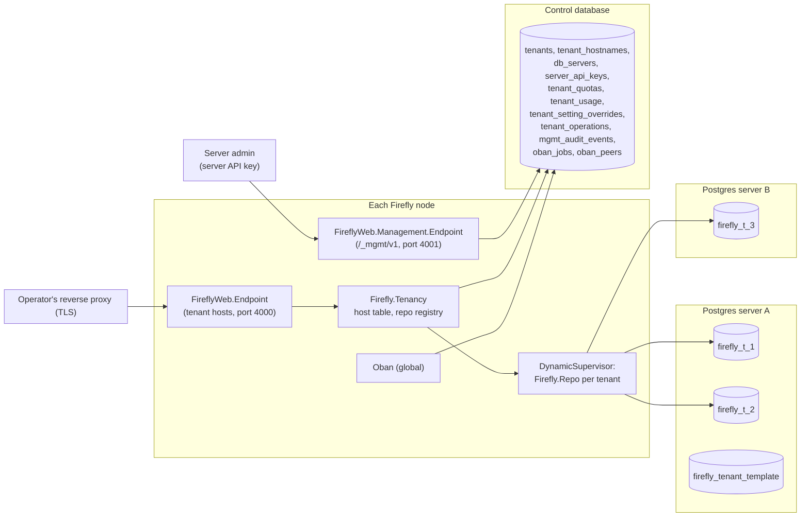
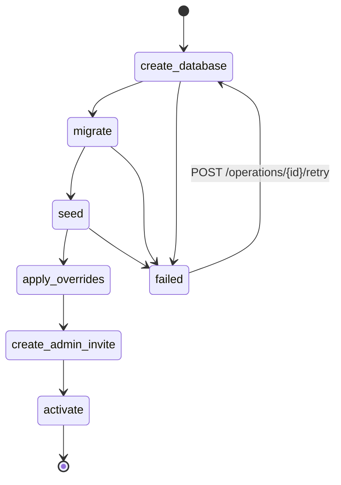
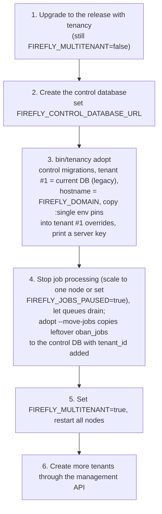

# Multi-tenancy: one server, many forums

Status: **design, for review**. No code yet; section 11 plans the stack of
pull requests that implements it.

This document turns Firefly from a single forum per deployment into a server
that hosts many forums ("tenants"). It records the decisions already made,
recommends answers to the ones still open, and names the modules, tables,
processes and configuration keys the implementation will add or change.

## Decisions already made (binding)

1. **Isolation: one PostgreSQL database per tenant**, as in Discourse's
   multisite: dynamic Ecto repos, a connection pool per tenant, per-tenant
   migrations.
2. **Routing by hostname.** Each tenant has one or more hostnames: a
   subdomain of a base domain, plus optional custom domains, registered
   through the management API. TLS for custom domains is the operator's
   reverse proxy's job.
3. **Users are per tenant.** The same email on two forums is two accounts.
4. **Management API v1** covers the tenant lifecycle (create, list, update,
   suspend, resume, delete, hostnames, first-admin invite), server API keys
   (scoped; create, rotate, revoke; the first one bootstrapped by a release
   command or an environment variable), per-tenant settings overrides and
   quotas (storage, members, AI usage, rate limits), and tenant export and
   import (data plus uploads) to move a tenant between clusters.

## What the design assumes about work in flight

| Work | State when this was written | What is assumed |
| --- | --- | --- |
| #111 Swoosh mail | On `origin/feat/swoosh-mail`, and included in `origin/feat/oban`. `master` still sends with Bamboo (`config/config.exs`: `Bamboo.LocalAdapter`; `apps/firefly/lib/firefly/mailer.ex`) | Merged before this stack starts. `Firefly.Mailer` wraps Swoosh with `FIREFLY_MAIL_ADAPTER` (smtp, ses, sendgrid, mailgun, postmark), as on that branch's `config/runtime.exs` |
| #114 Oban, first PR | Pushed as `origin/feat/oban`: `Firefly.Jobs` (`apps/firefly/lib/firefly/jobs.ex`), `Firefly.Jobs.Pruner`, the `oban_jobs` migration, `config :firefly, Oban` with `repo: Firefly.Repo`, `Oban.Notifiers.Postgres`, `Oban.Peers.Database`, seven queues, Oban Web at `/staff/jobs` (`FireflyWeb.JobsDashboard`), the `job_retention_days` setting, Oban status in `/ready` | As on the branch |
| #115 onward (Oban stack) | Not pushed | Cron (today `Firefly.Moderation.TopicTimers.Scheduler`, `apps/firefly/lib/firefly/moderation/topic_timers.ex`) moves to Oban's cron plugin; plugin events and webhook deliveries (today `Firefly.Plugins.Queue`) move to Oban workers; notification fan-out (today the `Firefly.Notifications` GenServer), AI, Akismet, web push and link-preview tasks (today `Task.Supervisor`s in `apps/firefly/lib/firefly/application.ex`) become Oban jobs. Workers are plain `use Oban.Worker` modules enqueued through `Firefly.Jobs.insert/1` |
| libcluster with `libcluster_postgres` | `feat/libcluster-postgres` not pushed. Today there is no clustering at all: no libcluster, no `dns_cluster`, nothing in `rel/` sets up distribution, so `Firefly.PubSub` broadcasts reach only the local node even where moduledocs say "every node" | A `Cluster.Strategy.Postgres` topology in `Firefly.Application`, configured with a database URL and a channel name |

Everything listed as merged in the brief was checked on `master` (at
`4c48eaec`): health and readiness (`FireflyWeb.Plugs.Health`,
`Firefly.Health`), Prometheus (`FireflyWeb.Metrics`, `FireflyWeb.Telemetry`),
OpenTelemetry (`FireflyWeb.OpenTelemetry`), packages (`Firefly.Packages`),
Kaffy at `/staff/db` (`FireflyWeb.Admin`, `FireflyWeb.Plugs.DatabaseAdmin`),
typed site settings with `FIREFLY_SETTING_*` pins (`Firefly.SiteSettings`),
scoped API keys (`Firefly.Accounts.ApiKeys`) and the OpenAPI 3.1 document
(`FireflyWeb.Api.V1.OpenAPI`), uploads on disk or S3
(`Firefly.Uploads.Storage`), backups (`Firefly.Backups`) and the MCP server
(`FireflyWeb.MCPController`, `Firefly.AI.MCP`).

## Summary of recommendations

* A **control plane** (its own database and `Firefly.Control.Repo`) holds
  tenants, hostnames, database servers, server API keys, quotas, usage,
  settings overrides, operations, idempotency keys, support sessions and the
  management audit log. It also hosts **the one global Oban** and the
  **libcluster channel**.
* **`Firefly.Repo` stays the one repo module.** Each tenant gets an instance
  of it, started under a `DynamicSupervisor` with an atom name per tenant,
  found through `Firefly.Tenancy`, and selected per process with
  `put_dynamic_repo/1`. Its default dynamic repo is a name that is never
  started, so **a process without a tenant cannot query anything**.
* **Tenants are resolved by host** in the endpoint, before the session, from
  an in-memory table refreshed cluster-wide. Every signed artifact (session,
  tokens, reply addresses) is **bound to the tenant**, so nothing signed for
  one forum works on another.
* **Per-process caches move from `:persistent_term` to ETS keyed by tenant.**
  PubSub topics, rate-limit keys, upload keys and backup paths get a tenant
  prefix in one central place each.
* The **management API** is a second Phoenix endpoint on its own port
  (`/_mgmt/v1`), authenticated by scoped, hashed server keys, documented by
  OpenAPI 3.1, with idempotent creates and asynchronous operations.
* **Single-tenant mode stays first-class**: it is multi-tenant mode with one
  implicit tenant and no control plane. An existing install becomes tenant
  #1 of a multi-tenant server with zero data copy, and can go back.

---

## 1. Control plane and tenant plane



### 1.1 The control database

A new top-level context, **`Firefly.Control`** (`apps/firefly/lib/firefly/control.ex`,
a `use Boundary` facade like the others, registered in
`Firefly.BoundariesTest`), owns the control plane:

* **`Firefly.Control.Repo`**: a static `Ecto.Repo` (`otp_app: :firefly`),
  configured from `FIREFLY_CONTROL_DATABASE_URL` and
  `FIREFLY_CONTROL_DATABASE_POOL_SIZE` (default 10). Its migrations live in
  `apps/firefly/priv/control_repo/migrations` (Ecto's default path for the
  module name), so they never mix with the tenant migrations in
  `apps/firefly/priv/repo/migrations`. It is added to `ecto_repos` only in
  multi-tenant mode.
* Its tables:

| Table | Columns (main) | Purpose |
| --- | --- | --- |
| `tenants` | `id` bigint, `public_id` uuid (unique; used in prefixes and signatures), `slug` citext unique, `name`, `status` (`provisioning`, `active`, `suspended`, `read_only`, `deleting`, `deleted`, `failed`), `status_reason`, `suspended_message`, `db_server_id`, `db_name`, `db_username`, `db_password` (encrypted, see 10.6), `pool_size` (default 2), `schema_version` bigint, `schema_status` (`current`, `pending`, `migrating`, `failed`), `schema_error`, `features` jsonb, `legacy` boolean, `purge_after`, `deleted_at`, timestamps | One row per forum |
| `tenant_hostnames` | `tenant_id`, `hostname` citext unique, `kind` (`subdomain`, `custom`), `primary` boolean (partial unique index: one primary per tenant), `verification_token`, `verified_at` | Host routing |
| `db_servers` | `id`, `name`, `admin_url` (encrypted; a role with `CREATEDB CREATEROLE`), `tenant_url` (encrypted template for tenant connections, e.g. through PgBouncer), `max_tenants`, `status` (`open`, `closed`, `draining`) | Where tenant databases are placed (section 9.2) |
| `server_api_keys` | `id`, `name`, `prefix`, `token_hash`, `scopes` text[], `allowed_ips` text[], `expires_at`, `revoked_at`, `last_used_at`, `last_used_ip`, `created_by_key_id`, `rotated_from_id` | Management API auth |
| `tenant_quotas` | `tenant_id` (pk), `storage_bytes`, `members`, `ai_requests_per_month`, `ai_tokens_per_month`, `requests_per_minute`, `plugin_calls_per_minute`, `live_sockets` (all nullable: null means unlimited) | Limits |
| `tenant_usage` | `tenant_id`, `period` (first day of month), `storage_bytes`, `members`, `ai_requests`, `ai_tokens`, `requests`, `updated_at` | Counters the quotas are checked against (section 6.7) |
| `tenant_setting_overrides` | `tenant_id`, `key`, `value` jsonb, `locked` boolean, `updated_by_key_id`, timestamps | Server-imposed site settings (section 4.1) |
| `tenant_operations` | `id` uuid, `tenant_id`, `kind` (`provision`, `migrate`, `suspend`, `resume`, `delete`, `purge`, `export`, `import`), `status` (`queued`, `running`, `succeeded`, `failed`, `cancelled`), `step`, `progress` jsonb, `error`, `result` jsonb, `server_key_id`, timestamps | The status resource for asynchronous work |
| `mgmt_idempotency_keys` | `key`, `server_key_id`, `request_hash`, `status`, `response` jsonb, `expires_at` | Idempotent creates |
| `mgmt_audit_events` | `id`, `at`, `server_key_id`, `action`, `tenant_id`, `target`, `params` jsonb (secrets redacted), `ip`, `request_id`, `result` | Every management action, append-only |
| `support_sessions` | `id`, `tenant_id`, `server_key_id`, `reason`, `token_hash`, `expires_at`, `used_at`, `ended_at` | Server admins acting inside a tenant (section 5.3) |
| `server_settings` | `key`, `value` jsonb | Settings that belong to the server, not a forum: `job_retention_days`, the version check, defaults for new tenants |
| `oban_jobs`, `oban_peers` | Oban's | The global job queue (1.2) |

The tenant database keeps every table it has today. It gains nothing that
names a tenant: **no `tenant_id` column anywhere in tenant data**, which is
what makes export and import a plain dump and restore (section 6.8).

### 1.2 Where Oban lives: one global Oban on the control database

**Recommendation: one Oban instance per node, on the control database, with
`tenant_id` in every job's args and a worker wrapper that switches the
dynamic repo.** Rejected: one Oban instance per tenant database.

| | Global Oban on the control DB | Oban per tenant DB |
| --- | --- | --- |
| Connections | One `LISTEN` connection per node for `Oban.Notifiers.Postgres`, and Oban's queries share the control pool | One `LISTEN` connection per tenant per node, held permanently: 500 tenants on 3 nodes is 1,500 idle connections before any request |
| Polling | 7 queue producers per node | 7 producers × N tenants per node, each staging jobs every second: every tenant's pool stays open, so idle pools never shut down (2.3) |
| Cron | One cron plugin, one leader (`Oban.Peers.Database`); cron entries fan out to tenants (below) | N leaders, N cron plugins firing the same entries in N databases |
| Uniqueness | Unique keys include `tenant_id`; one table to check | Natural per tenant, but nothing global (e.g. "one migration job per tenant across the cluster" is easy in the global design) |
| Transactional enqueue | Lost: the job row is in another database than the tenant data (mitigated below) | Kept |
| Ops | One Oban Web, one place to see the fleet's backlog | N dashboards; Oban Web would need an instance switcher |
| Fairness | Shared queues: a busy tenant can delay others (mitigated below) | Isolated by construction |

The connection and polling costs grow with the number of tenants and decide
it. The two losses are handled like this:

* **Enqueue after commit.** `Firefly.Jobs.insert/1` (from the Oban branch)
  defers when called inside a tenant transaction: it appends the changeset
  to a process-dictionary buffer, and `Firefly.Repo.transact/2` (a thin
  override in `apps/firefly/lib/firefly/repo.ex`) inserts the buffered jobs
  after the outermost transaction commits, and drops them when it rolls
  back. A crash between commit and insert loses the job, so work that must
  not be lost keeps a marker in the tenant database and a periodic sweep
  re-enqueues it (notification fan-out: `posts.notified_at IS NULL`;
  webhook deliveries: the `webhook_deliveries` rows already exist). Workers
  treat missing rows as success (`:discard`), since the transaction that
  made them may have rolled back.
* **Fairness.** Bulk work (imports, exports, backups, rebakes, migrations,
  provisioning) gets its own queues (`bulk`, `tenancy`) with low
  concurrency, so it never occupies the interactive queues. Each worker
  checks a per-node, per-tenant in-flight counter
  (`Firefly.Jobs.Fairness`, an ETS `update_counter`) and returns
  `{:snooze, 5}` when the tenant already holds more than
  `FIREFLY_JOBS_TENANT_SHARE` (default 50%) of the queue's concurrency.
  Oban Pro's partitioned global limits would do this better; see open
  question 1.

**The worker wrapper.** `use Firefly.Jobs.Worker, queue: ..., ...` replaces
`use Oban.Worker` for every tenant job. It defines `perform/1`, which reads
`"tenant_id"` from the args, loads the tenant (cached), and:

* returns `{:cancel, :tenant_gone}` if the tenant is `deleted` or unknown;
* returns `{:snooze, 60}` if it is `suspended`, `read_only` or its
  `schema_status` isn't `current` (jobs wait instead of failing);
* otherwise runs the module's `run/1` inside `Firefly.Tenancy.with_tenant/2`
  (2.4), which also sets logger metadata and the span attribute.

`Firefly.Jobs.Worker.new/2` refuses to build a job without a tenant in the
caller's context (fail-closed), and puts `tenant_id` in the args itself, so
callers never write it. Unique options always include `:tenant_id` in
`keys`. An expression index, `CREATE INDEX oban_jobs_tenant_id ON oban_jobs
((args->>'tenant_id'))`, serves the per-tenant jobs page and purges.

**Cron.** Two kinds of periodic work exist in
`Firefly.Moderation.TopicTimers.Scheduler`'s `@jobs` today:

* *Due-time work* (thread timers, bookmark reminders, poll closings): the
  Oban stack should schedule an exact job (`scheduled_at`) when the timer is
  set, instead of polling every 30 seconds. Polling every tenant every 30
  seconds would keep every tenant's pool open.
* *Maintenance* (trust levels, badges, digests, directory stats, analytics
  pruning, link preview cleanup, egress log pruning, email log pruning,
  scheduled backups, the embedding feed, chat retention, AI embeddings):
  one Oban cron entry per kind enqueues `Firefly.Jobs.FanOut` on the
  `tenancy` queue, which inserts one `Firefly.Jobs.Periodic` job per
  `active` tenant (`args: %{tenant_id, task}`, unique per tenant and task
  for the period), spread over the period by `hash(tenant_id)` so a
  thousand tenants don't wake at once.
* The daily version check (`Firefly.Upgrades`) and the Oban pruner are
  server work: they run once, without a tenant.

The pruner on the Oban branch reads `Firefly.SiteSettings.get("job_retention_days")`.
With no tenant in the pruner's process that call fails closed, as it
should: `job_retention_days` becomes a server setting (`server_settings`,
pinned by `FIREFLY_JOB_RETENTION_DAYS`) in multi-tenant mode, and stays a
site setting in single-tenant mode.

### 1.3 Where libcluster's channel lives

On the **control database**: `libcluster_postgres` connects with
`FIREFLY_CONTROL_DATABASE_URL` and listens on the channel
`FIREFLY_CLUSTER_CHANNEL` (default `firefly_cluster`). Nodes of one cluster
already share the control database, and it is the one database that every
node must reach. In single-tenant mode the channel is on the forum's
database, as the libcluster branch presumably does. Both the Oban notifier
and the libcluster listener need session-level `LISTEN`, so the control
database is reached directly, never through PgBouncer in transaction mode
(9.1).

Clustering matters more with tenants: cache invalidation (4.1) and host
table updates (3.1) travel over `Firefly.PubSub`, which needs connected
nodes. Each invalidating cache also reloads on a timer as a backstop (60 s),
so a partitioned node serves stale data for at most that long.

### 1.4 Where `/health` and `/ready` check

* `GET /health` is unchanged: no database, answered by
  `FireflyWeb.Plugs.Health` before tenant resolution, on any host.
* `GET /ready` in multi-tenant mode checks the **control database**
  (`SELECT 1`), **pending control migrations**, and Oban status (reported,
  not failing, as on the Oban branch). It does **not** check tenant
  databases: one broken tenant database server must not take every node out
  of the load balancer. It reports a fleet summary instead:
  `tenants: %{ok: true, active: 812, schema_pending: 0, schema_failed: 1,
  db_unreachable: 0}`.
* Per-tenant health is `GET /_mgmt/v1/tenants/{id}/health` (6.3): its
  database answers, its schema version, its pool.
* `Firefly.Health.readiness/0` gains a mode switch; single-tenant mode keeps
  today's checks exactly.

---

## 2. Repo design

### 2.1 One module, many instances

**Recommendation: keep `Firefly.Repo` as the only tenant repo module and
start one instance per tenant**, rather than defining a module per tenant
(modules can't be made at runtime without `Module.create/3` and code
loading, and would leak).

```elixir
# apps/firefly/lib/firefly/repo.ex (sketch)
defmodule Firefly.Repo do
  use Ecto.Repo,
    otp_app: :firefly,
    adapter: Ecto.Adapters.Postgres,
    # Never started: a process with no tenant set fails on its first query.
    default_dynamic_repo: Firefly.Repo.NoTenant

  use Scrivener, page_size: 10
end
```

`default_dynamic_repo` is an existing `use Ecto.Repo` option
(`deps/ecto/lib/ecto/repo.ex`). Because `Firefly.Repo.NoTenant` is never
started, any query from a process that didn't select a tenant raises
`could not lookup Ecto repo Firefly.Repo.NoTenant because it was not started
or it does not exist`. `Firefly.Tenancy` rescues nothing; the error is the
point.

* **Names.** Each tenant's instance is registered under an atom,
  `:"Firefly.Repo.T#{tenant.id}"`, built by `Firefly.Tenancy.Repos.name/1`.
  Atoms aren't collected, but there is one per tenant ever served by the
  node, far under the atom limit. A name rather than a pid matters: a
  LiveView that set its repo hours ago keeps working after the pool was
  stopped and started again (2.3), because the name is looked up on every
  checkout.
* **Supervision.** `Firefly.Tenancy.RepoSupervisor` (a `DynamicSupervisor`,
  `strategy: :one_for_one`, `max_restarts` generous) starts
  `{Firefly.Repo, name: name, url: ..., pool_size: tenant.pool_size, ...}`.
  `Firefly.Tenancy.RepoRegistry` (an ETS table owned by
  `Firefly.Tenancy.Repos`, keyed by tenant id) holds `{id, name, pid,
  last_used_at, pins}`. The brief's "registry keyed by tenant id" is this
  table; a `Registry` isn't needed since the names are atoms.
* **Single-tenant mode** starts `Firefly.Repo` statically under its own name
  (as `Firefly.Application` does now) and the implicit tenant's repo name is
  `Firefly.Repo`, so the same `put_dynamic_repo` path runs in both modes.

### 2.2 Pool sizing and the connection budget

* `tenants.pool_size` (default `FIREFLY_TENANT_POOL_SIZE`, 2) per tenant per
  node. Big tenants get more through the management API (`PATCH
  /tenants/{id}` with `pool_size`).
* **A node budget**: `FIREFLY_TENANT_CONNECTION_BUDGET` (default 100) caps
  the sum of `pool_size` over the pools running on a node.
  `Firefly.Tenancy.Repos.ensure_started/1` checks the budget before starting
  a pool; over budget, it stops the least recently used pool that has no
  pins and has been idle at least 30 seconds, then starts. If none can be
  stopped, the request waits up to 2 seconds for one and then gets a `503`
  with `Retry-After` (and the event `[:firefly, :tenancy, :pool, :rejected]`).
* The control repo, the Oban notifier and the libcluster listener are
  outside the budget: `control pool + 2`.

### 2.3 Lazy start, idle shutdown

* Pools start on first use: `Firefly.Tenancy.Repos.ensure_started/1` is
  called at every entry point (2.4). It is an ETS lookup when the pool runs,
  and it also bumps `last_used_at` (a `:ets.update_element/3`, at most once a
  second per tenant).
* `Firefly.Tenancy.RepoReaper` (a GenServer) runs every minute and stops
  pools idle longer than `FIREFLY_TENANT_POOL_IDLE_MS` (default 10
  minutes) that have no pins.
* **Pins** keep a pool alive for long work: `Firefly.Tenancy.pin/1` records
  the calling process (monitored) in the registry row; exports, imports,
  backups, migrations and LiveView processes pin. A pinned LiveView doesn't
  hold a connection, only the pool, so hundreds of open pages on a tenant
  cost its 2 connections. Pins are dropped when the process exits.
* Stopping a pool while a query is in flight can't happen to a pinned
  process; for an unpinned one (a short request) the reaper only stops
  pools idle for 10 minutes, so the window is a request that started over
  10 minutes ago and hasn't queried since. It gets a
  `DBConnection.ConnectionError`, as during a database restart.

### 2.4 How every process gets its tenant

The tenant lives in the process dictionary, as Ecto's dynamic repo does.
`Firefly.Tenancy` (new top-level context, exports `Tenant`) is the only API:

| Function | Does |
| --- | --- |
| `put(tenant)` | Ensures the pool runs, `Firefly.Repo.put_dynamic_repo(name)`, stores the `%Firefly.Tenancy.Tenant{}`, sets `Logger.metadata(tenant: slug)` and the OpenTelemetry attributes |
| `current()` / `current!()` | The tenant, or `nil` / raises `Firefly.Tenancy.NoTenantError` |
| `with_tenant(tenant_or_id, fun)` | Runs `fun` with the tenant, restoring the previous one afterwards |
| `async(fun)`, `start_child(supervisor, fun)`, `async_stream(...)` | `Task.Supervisor` wrappers that capture the caller's tenant and set it in the child |
| `context()` / `restore(context)` | The tenant plus OpenTelemetry context as one term, for code that hands work to another process |
| `topic(name)` | The tenant's PubSub topic (4.6) |
| `key(term)` | `{tenant_id, term}` for caches and rate limits |

Where it is set:

| Process | How |
| --- | --- |
| HTTP request | `FireflyWeb.Plugs.Tenant` in `FireflyWeb.Endpoint` (3.1) |
| LiveView (connected) | `on_mount FireflyWeb.TenantHook`, first in every `live_session` in `apps/firefly_web/lib/firefly_web/router.ex`: resolves the tenant from `socket.host_uri`, checks it matches the session's tenant binding (3.3), calls `Firefly.Tenancy.put/1`, pins the pool, and attaches `handle_event`/`handle_info` hooks that call `ensure_started/1` so a reaped pool comes back |
| Channels (`FireflyWeb.UserSocket`) | `connect/3` with `connect_info: [:uri]` resolves the tenant; each channel's `join/3` calls `Firefly.Tenancy.put/1` from `socket.assigns.tenant_id` |
| Oban jobs | `Firefly.Jobs.Worker` (1.2) |
| `Task` children | `Firefly.Tenancy.async/1` and friends. `Firefly.Telemetry.bind/1` (`apps/firefly/lib/firefly/telemetry.ex`) already wraps functions handed to other processes for trace context; it carries the tenant too |
| PubSub handlers | Messages are received by processes that already have a tenant (LiveViews, channels). Node-level subscribers (cache invalidators) receive `{tenant_id, message}` and act inside `with_tenant/2` |
| GenServers | Node-level servers (`Firefly.Analytics.Buffer`, `Firefly.Plugins.Registry`, `Firefly.SiteSettings.Cache`, `Firefly.Backups.Runner`) carry the tenant id in every message and call `with_tenant/2` per message. None keeps "the" tenant in its state |
| Plugin sandbox | `Firefly.Plugin.Runner` runs calls under `Firefly.Plugin.TaskSupervisor` via `Firefly.Tenancy.async/1`; `Firefly.Plugin.Host` functions (storage, HTTP, notify) then run with the caller's tenant. `FireflyPlugins.Runtime` itself is tenant-free: a fresh wasm instance per call |
| Release commands, `mix` tasks, IEx | `Firefly.Tenancy.with_tenant("slug", fn -> ... end)`; `FireflyImport.CLI` gains a required `--tenant` option in multi-tenant mode; `priv/repo/seeds.exs` runs per tenant |

**Fail-closed everywhere.** Besides the repo default, `current!/0` raises,
`topic/1`, `key/1`, `Firefly.Endpoint.url/0`, `Firefly.Uploads.Storage` and
`Firefly.RateLimit` call `current!/0`. Nothing falls back to a "default"
tenant, in either mode. Two static checks keep it that way:

* A Credo check, `Firefly.Credo.TenantlessSpawn`, flags `Task.async`,
  `Task.start`, `Task.Supervisor.*`, `spawn` and `Phoenix.PubSub.*` calls in
  `apps/firefly` and `apps/firefly_web` outside `Firefly.Tenancy` and an
  allowlist of node-level modules.
* A test in the style of `Firefly.BoundariesTest` lists every
  `:persistent_term.put` and `:ets.new` call site and fails on new ones that
  aren't on an allowlist with a reason.

### 2.5 Tests

* `config/test.exs` defines a control database (`firefly_test_control`) and
  two tenant databases (`firefly_test_t1`, `firefly_test_t2`, with
  `MIX_TEST_PARTITION` appended), migrated by `mix test`'s alias. Their repos
  start once, statically, with `pool: Ecto.Adapters.SQL.Sandbox`, under the
  same atom names production would use.
* `Firefly.DataCase` and `FireflyWeb.ConnCase` check out tenant 1's repo and
  call `Firefly.Tenancy.put(t1)` in setup, so **the whole existing suite runs
  under multi-tenant tenancy** and exercises fail-closed paths without
  changing a test. `FireflyWeb.ConnCase` sets `conn.host` to `t1.test`.
* `Firefly.MultiTenantCase` (new) checks out both tenant repos and the
  control repo and gives `in_tenant(t, fun)` helpers and fixtures that build
  matching data in both tenants.
* Sandbox allowances follow `$callers` as today; `Firefly.Tenancy.async/1`
  keeps `$callers`. For e2e, `Phoenix.Ecto.SQL.Sandbox.metadata_for/2` takes
  the list of repo names, and browsers visit `http://t1.localhost:4002`
  (Chromium resolves `*.localhost` to loopback).
* A CI job runs a smoke subset (`--only single_mode`) with
  `FIREFLY_MULTITENANT=false`.

---

## 3. Tenant resolution

### 3.1 Host lookup in the endpoint

`FireflyWeb.Plugs.Tenant` goes into `FireflyWeb.Endpoint` after
`FireflyWeb.ClientIP` (so it knows whether to trust `X-Forwarded-Host`) and
before `Plug.Session`:

```elixir
plug(FireflyWeb.Plugs.Health)      # tenantless
plug(FireflyWeb.Metrics)           # tenantless
plug(Plug.Static, ...)             # shared assets, tenantless
plug(FireflyWeb.ClientIP)
plug(FireflyWeb.Plugs.Tenant)      # new
plug(Plug.RequestId)
...
plug(Plug.Session, ...)
plug(FireflyWeb.Router)
```

* **Normalising**: lowercase, strip the port and a trailing dot, IDNA to
  ASCII. `X-Forwarded-Host` is used only when the peer is a trusted proxy
  (`FIREFLY_TRUSTED_PROXIES`, as `FireflyWeb.ClientIP` already decides).
* **Cache**: `Firefly.Tenancy.Hosts` owns two ETS tables, `:firefly_hosts`
  (`hostname => tenant_id`) and `:firefly_tenants` (`id => %Tenant{}`),
  loaded completely from the control database at boot (thousands of rows are
  cheap) and kept fresh by `{:tenant_changed, id}` on the control-plane topic
  `"control:tenants"`, plus a full reload every 60 seconds. Every control
  write to `tenants` or `tenant_hostnames` broadcasts after commit. Since the
  whole table is in memory, an unknown host never reaches the database.
* **Unknown host**: `404` with a static page and no session cookie.
* **The server host** (`FIREFLY_SERVER_HOST`, e.g. `firefly.example.com`) is
  not a tenant: only `/inbound/*` (3.6) is served there; anything else is a
  404.
* **Status**:
  * `suspended`: `503` with the tenant's `suspended_message` (or a default)
    as HTML, `application/problem+json` for `/api/*`, `Retry-After` unset.
  * `provisioning`, `failed`, or `schema_status` not `current`: `503`
    "This forum is being set up / under maintenance", `Retry-After: 60`.
  * `read_only`: served, with writes refused (4.13).
  * `deleting`, `deleted`: `404`, as if unknown; the host stays reserved
    until purge.
* It then calls `Firefly.Tenancy.put/1`, `put_router_url(conn, tenant.url)`
  (3.4), and stores `conn.private.firefly_tenant`.

### 3.2 Cookies and session scope

* The session cookie has no `Domain` attribute today
  (`apps/firefly_web/lib/firefly_web/endpoint.ex`, `@session_options`), so
  browsers keep one per host. That stays.
* **Cookie tossing.** A page on `evil.forums.example` can set a cookie with
  `Domain=forums.example` that browsers then send to every sibling tenant.
  Tenant admins can run their own scripts (theme HTML from an admin's own
  theme runs scripts, per `Firefly.Packages`' moduledoc), so this is
  reachable. In multi-tenant mode the session cookie is named
  **`__Host-firefly_session`**: browsers refuse a `__Host-` cookie with a
  `Domain` attribute, so siblings can't set it. Plug.Session's options are
  compile-time in the endpoint, so the cookie key moves to runtime config
  read by a small `FireflyWeb.Session.Plug` wrapper. Dev uses
  `firefly_session` (no `__Host-`: it needs HTTPS).
* The legacy tenant (8.1) keeps reading `_firestorm_web_key` for one release
  and rewrites it as the new cookie, so nobody is logged out by the upgrade.
* Operators should also put the base domain on the Public Suffix List when
  tenants are untrusted (open question 8).

### 3.3 Binding the session to the tenant

`FireflyWeb.Session` stores the user id in `"current_user"` and loads it
with `Firefly.Accounts.get_user/1`. All tenants share one
`secret_key_base`, so a signed cookie from tenant A is valid on tenant B,
and user id 5 on A is someone else on B. Without a fix, **anyone can copy
their own cookie to another forum and be logged in as whoever has their id
there.**

Fix: the session stores `"tenant"` (the tenant's `public_id`) next to
`"current_user"`. `FireflyWeb.Plugs.Tenant` (after the session is fetched,
via a router plug in every pipeline that fetches the session) and
`FireflyWeb.TenantHook` drop a session whose `"tenant"` doesn't match the
host's tenant (`configure_session(conn, drop: true)`). The legacy tenant
also accepts a session without the key for one release.

Per-tenant `secret_key_base` (deriving `conn.secret_key_base` per tenant)
was considered and rejected: LiveView signs its session tokens and reads the
socket's session cookie with the endpoint's configured secret, not the
conn's, so it would break LiveView without an upstream change. Binding the
content is enough and works everywhere.

### 3.4 CSRF, `check_origin`, URLs

* **CSRF**: `protect_from_forgery` keeps its token in the session, which is
  per host and tenant-bound; nothing more to do.
* **`check_origin`** for `/live` and `/socket`: `check_origin:
  {Firefly.Tenancy.Hosts, :origin_allowed?, []}` in the endpoint config
  (Phoenix accepts an MFA called with the origin's `URI`). It allows any
  hostname in `:firefly_hosts` whose tenant is `active` or `read_only`. The
  socket then must match the *same* tenant as the session (3.3), so a page on
  host A can't open a socket on host B.
* **URL generation**: `Firefly.Endpoint.url/0` (the domain's port,
  `apps/firefly/lib/firefly/endpoint.ex`) returns
  `Firefly.Tenancy.current!().url`, the primary hostname over https. Every
  absolute URL the domain builds goes through `Firefly.URLs`
  (`apps/firefly/lib/firefly/urls.ex`), which uses it, so emails, push
  payloads, webhooks and plugin events get the right host. In the web app,
  `FireflyWeb.Plugs.Tenant` calls `Phoenix.Controller.put_router_url/2` so
  `url(conn, ~p"...")` uses the tenant's host; the 5 bare `url(~p"...")`
  and 5 `FireflyWeb.Endpoint.url()` call sites in `apps/firefly_web/lib`
  (which use the endpoint's static URL) are changed to the conn or socket
  form or to `Firefly.URLs`, and a test fails on new bare ones.
  The endpoint's own `url` config becomes the server host; nothing
  tenant-facing uses it.
* **Primary vs alias hosts**: requests on a non-primary hostname get a `301`
  to the primary, unless the hostname is marked `serve: true` (custom domain
  during a cut-over). Canonical tags and sitemaps (`Firefly.SEO`) use the
  primary.

### 3.5 Email links and outbound mail

* Links: through `Firefly.URLs`, so per tenant (3.4). Jobs that send mail
  run inside their tenant (1.2).
* Sender (**decided: mail credentials per tenant**): each tenant may set its
  own mail adapter and credentials (SMTP, SES, SendGrid, Mailgun, Postmark:
  the same set as #111) as secret tenant settings, editable by the tenant's
  admins at `/staff/settings` and by the server admin through the
  management API (6.3). They are encrypted at rest (10.3) and never shown
  back, only replaced.
  * `Firefly.Mailer` builds the Swoosh config per send from the current
    tenant (`Swoosh.Mailer.deliver/2` takes a config), so the `mailers`
    queue's jobs resolve the tenant's adapter when they run (1.2).
  * A tenant without its own adapter uses the server-wide one from env,
    with the default `From` `"<tenant title>" <FIREFLY_EMAIL_FROM>` (a server
    address on a domain the operator authenticated with SPF/DKIM), so
    tenants need no DNS work. With its own adapter, the tenant also sets its
    own `email_from` and owns its domain's SPF/DKIM.
  * SMTP hosts and API endpoints a tenant enters go through the egress
    guard (4.4): no private, loopback or cluster addresses, so tenant mail
    settings can't be used to reach internal services.
  * The staff "send test email" and the email log work per tenant as today;
    a tenant's adapter errors show only to that tenant.
* `Firefly.Notifications.EmailLog` stays per tenant database.

### 3.6 Inbound email

`Firefly.Notifications.ReplyAddress` builds
`reply+<thread>-<user>-<signature>@<reply domain>`. In multi-tenant mode:

* The address becomes `reply+<tenant public id, base32>.<thread>-<user>-<signature>@<FIREFLY_REPLY_EMAIL_DOMAIN>`,
  one reply domain for the server.
* The signature key is derived per tenant (10.4), so an address can't be
  replayed to another tenant even with the prefix edited.
* SendGrid's Inbound Parse posts to `https://<FIREFLY_SERVER_HOST>/inbound/sendgrid?token=...`.
  `FireflyWeb.InboundController` parses the tenant prefix first, then runs
  the rest of `sendgrid/2` inside `Firefly.Tenancy.with_tenant/2`. Unknown or
  inactive tenants are dropped with a log line, as unverifiable addresses
  are today. The legacy tenant also accepts the old address form, so
  replies to mail sent before the upgrade still work.

### 3.7 Embeds and CORS

* `/embed.js` and `/embed/comments` (`FireflyWeb.EmbedController`) are per
  host: the script is served from the tenant's host, and `frame-ancestors`
  comes from that tenant's `embeddable_hosts` (tenant data,
  `Firefly.Embedding.frame_ancestors/0`), so no change beyond tenant
  context.
* `/api/v1` uses `CORSPlug` with any origin, because it authenticates with
  bearer keys and not cookies; keys are per tenant database (10.9). No
  change.
* `/mcp` refuses foreign `Origin` headers by comparing with the endpoint's
  host; it compares with the tenant's hostnames instead.

---

## 4. What is global today and must become per tenant

Each row was found by reading the code. "Fix" names the module that changes.

### 4.1 Site settings and their cache

* Today: `Firefly.SiteSettings` (`apps/firefly/lib/firefly/site_settings.ex`)
  caches all values in `:persistent_term` under one key, invalidated by a
  generation ref and the `"site_settings"` PubSub topic handled by
  `Firefly.SiteSettings.Cache`.
* Fix: the cache becomes an ETS table, `:firefly_settings_cache`, keyed by
  `{tenant_id, :values}` with the generation per tenant. `:persistent_term`
  is wrong for per-tenant data: every `put` or `erase` makes the VM scan
  every process's heap, and with hundreds of tenants changing settings that
  is a constant global GC. Invalidation messages carry the tenant id.
* **Value precedence** (highest first), each shown at `/staff/settings`
  with its source:
  1. `FIREFLY_SETTING_<KEY>` env pins whose setting has `pin_scope: :server`
     (policies that should hold on every forum, e.g.
     `FIREFLY_SETTING_ALLOW_REGISTRATIONS=false` on a demo server);
  2. `tenant_setting_overrides` rows with `locked: true` (server admin
     policy for this tenant; read-only for the tenant admin);
  3. the tenant admin's value (`forums_site_settings` in the tenant DB);
  4. `tenant_setting_overrides` with `locked: false` (a server-chosen
     default the tenant admin may change);
  5. the definition's default.
* Each setting definition gains `pin_scope`: `:server` (the env pin applies
  to every tenant) or `:single` (the env pin applies only in single-tenant
  mode, and to the legacy tenant: titles, credentials, `FIREFLY_SETTING_TITLE`).
  It also gains `scope: :server_only` for settings a tenant admin must not
  see in multi-tenant mode: `enable_database_admin`, backup storage, the
  version check, `job_retention_days`.

### 4.2 Emoji, watched words and other per-node caches

| Cache today | Where | Fix |
| --- | --- | --- |
| Custom emoji, `:persistent_term` | `Firefly.Rendering.Emoji` (`rendering/emoji.ex`), loaded by `Firefly.SiteSettings.Cache` at boot | ETS keyed by tenant, loaded lazily on first use (no boot-time loading for N tenants) |
| Watched words regexes, `:persistent_term` | `Firefly.Moderation.WatchedWords` | Same |
| Active plugins, `:persistent_term` | `Firefly.Plugins.active/0` (`plugins.ex`), reloaded by `Firefly.Plugins.Registry` | Same; `Registry` stops loading every plugin at boot (it would touch every tenant) and loads per tenant on first use |
| Plugin stats and circuit breaker, ETS | `Firefly.Plugins.Health` | Key `{tenant_id, plugin_id}`: today a plugin tripping on one forum would trip the same plugin id on all |
| Plugin-transformed post cache | `Firefly.Plugins.Content.cache_spec()` | Key by tenant |
| Theme CSS, `:persistent_term` `{cache, theme_id}` | `Firefly.Themes` (`themes.ex`) | Key `{tenant_id, theme_id}`: theme ids repeat across tenant databases, so today's key would serve one forum's CSS to another |
| Reports, ETS | `Firefly.Reports.Cache` | Key by tenant |
| OEmbed results, `LruCache :oembed_cache` | `Firefly.Rendering.OEmbed`, `Firefly.Application` | Key `{tenant_id, url}`, so one forum can't learn what another previewed; size cap stays global |
| SAML metadata, OIDC discovery, `:persistent_term` | `Firefly.Accounts.Auth.SAML`, `.OIDC` | ETS keyed by tenant (configs are per tenant, 4.11) |
| Apple client secret, `:persistent_term` | `Firefly.Accounts.Auth.AppleSecret` | Per tenant (credentials are per tenant) |
| AI encryption key, `:persistent_term` | `Firefly.AI.Encrypted` | Derived per tenant (10.4), cached by tenant |
| Analytics daily salt, `:persistent_term` | `Firefly.Analytics` | Key by tenant (the salt row is in the tenant DB) |
| Read-only mode, `:persistent_term` | `Firefly.Backups.Runner` | Per tenant, in ETS, plus `tenants.status = read_only` for server-imposed read-only (4.13) |
| Sandbox implementation, `:persistent_term` | `Firefly.Plugin.Sandbox` | Stays: node-level |
| Draining flag, `:persistent_term` | `FireflyWeb.Draining` | Stays: node-level |
| QuickJS compiled module | `FireflyPlugins.Runtime` | Stays: the engine is shared, plugin code is per call |

All per-tenant caches live in one module, `Firefly.Tenancy.Cache`
(`get/3`, `put/3`, `invalidate/2`, `drop_tenant/1`), backed by ETS tables
with `read_concurrency`, so suspending or deleting a tenant drops all its
entries at once (`:ets.match_delete` on `{tenant_id, :_}`).

### 4.3 Themes and compiled CSS URLs

`/theme-assets/:id/:version/theme.css` (`FireflyWeb.ThemeController`) is
resolved on the tenant's host, so the URL needs no tenant segment; the cache
key does (4.2). Browsers cache per host, so two tenants with the same theme
id and version don't collide in a browser.

### 4.4 The package registry: per tenant, with a server policy

**Recommendation: packages stay installed per tenant**, as today: the
`packages` and `plugins` tables are in the tenant database, staff manage
them at `/staff/packages`, and settings and plugin storage are tenant data.
Server-wide installs would make one forum's admin able to change every
forum.

The sandbox is already safe to share: every call gets a fresh wasm store,
32 MB of memory, a fuel budget and a 2 s deadline
(`FireflyPlugins.Runtime`). What a busy tenant can still do is use many
calls at once, so:

* a per-tenant concurrency cap on sandbox calls (`plugin_concurrency`
  feature, default 4 per node) in `Firefly.Plugin.Runner`, waiting briefly
  and then failing the hook (which the hook runner already tolerates);
* the per-tenant quota `plugin_calls_per_minute` (6.7);
* a server policy per tenant in `tenants.features.plugins`: `none`,
  `catalog` (default in multi-tenant mode: only packages from the server
  catalog) or `any` (uploads, URLs and GitHub, as today). The **server
  catalog** is a list of vetted package archives the server admin publishes
  (`server_packages` table, management API `PUT /packages/{id}`); tenants
  install from it at `/staff/packages`.
* `Firefly.Plugins.Egress` and webhook deliveries already refuse private
  addresses; the blocklist adds the management listener, the control
  database host and the cluster's own addresses.

### 4.5 Uploads

* Today keys are `original/ab/abcd....png` (`Firefly.Uploads.Storage`),
  content-addressed by hex digest, in `FIREFLY_UPLOAD_DIR` or one S3
  bucket. Two forums uploading the same file would share a key, and
  `Firefly.Uploads`' cleanup of unused uploads on one forum would delete the
  other's file.
* Fix: `Firefly.Uploads.Storage.put/3`, `delete/1` and `locate/3` prefix the
  key with `t/<tenant public id>/` (local: a subdirectory of
  `FIREFLY_UPLOAD_DIR`; S3: a key prefix in the shared bucket). The key
  stored in the tenant database doesn't change, so export and import move
  files without rewriting rows, and the legacy tenant's prefix is empty.
* A per-tenant bucket (`tenants.features.storage = %{bucket, region,
  credentials}`) is possible later; recommended against for v1 (open
  question 3).
* Upload URLs (`/uploads/:token/:name`) are random tokens looked up in the
  tenant database: a token from A is a 404 on B. No change.

### 4.6 PubSub topics

* Today about 30 call sites subscribe or broadcast directly on
  `Firefly.PubSub` or through `Firefly.Endpoint.broadcast/3`, with topics
  such as `"forums:thread:#{id}"`, `"conversation:#{id}"`,
  `"user_socket:#{id}"`, `"chat:channels"`, `"site_settings"`, `"plugins"`.
  Thread 12 exists on every forum, so **a LiveView on forum A watching
  thread 12 would receive forum B's new posts in thread 12.**
* Fix: `Firefly.Tenancy.topic/1` returns `"t:#{tenant_id}:" <> topic`, and
  every subscribe and broadcast goes through `Firefly.Broadcast`
  (`subscribe/1`, `broadcast/3`, `broadcast_from/4`, which call it).
  `Firefly.Endpoint.broadcast/3` prefixes too. Channel topics
  (`FireflyWeb.UserSocket`) and `FireflyWeb.Presence` keys are prefixed the
  same way. The Credo check in 2.4 forbids direct `Phoenix.PubSub` calls.
* Server-level topics are explicitly named `"control:*"` and only
  `Firefly.Tenancy` and `Firefly.Control` use them.
* `live_socket_id` (`Firefly.Accounts.UserSessions.live_socket_id/1`, used
  to disconnect a user's pages) is prefixed with the tenant too, or logging
  out user 5 on A would disconnect user 5 on B.

### 4.7 Rate limits

* Today `Firefly.RateLimit` (Hammer on ETS, per node) keys buckets by
  username, user id, IP, email, plugin id. A login brute-force against
  `bob` on A would lock out `bob` on B, and one forum's traffic would eat
  another's per-IP budget.
* Fix: `Firefly.RateLimit.check/2` and `check_api/2` key by
  `Firefly.Tenancy.key({bucket, key})`. Limits come from the tenant's
  settings (`rate_limit_<name>`, `posts_per_minute`), so per-tenant
  overrides (4.1) work with no new code.
* New tenant-wide limits: `requests_per_minute` (6.7).

### 4.8 Prometheus labels

**Recommendation: no `tenant` label on the existing metrics by default.**
`FireflyWeb.Telemetry` tags request metrics by `route`, `method`, `status`
and LiveView metrics by `view`; multiplying those by hundreds of tenants
multiplies series by hundreds and makes Prometheus slow and costly.

* New per-tenant series are few and bounded: `firefly_tenant_requests_total`,
  `firefly_tenant_pool_checkout_queue_seconds`, `firefly_tenant_pool_size`,
  `firefly_tenant_jobs_executing`, each with only a `tenant` label (the
  slug). They are on when `FIREFLY_METRICS_TENANT_LABELS=true` (default
  false), for clusters of up to a few hundred tenants.
* Per-tenant numbers at any scale come from the management API's usage
  endpoint (6.7) and `tenant_usage`.
* Node-level series: `firefly_tenancy_pools_running`,
  `firefly_tenancy_pool_budget_used`, `firefly_tenancy_pool_rejections_total`,
  `firefly_tenants{status}`.

### 4.9 OpenTelemetry

* The resource stays per node (`service.name`, `service.instance.id`):
  resources are per SDK, not per request.
* Every span gets `firefly.tenant.id` and `firefly.tenant.slug`, set on the
  request's root span by `FireflyWeb.Plugs.Tenant`, by `FireflyWeb.TenantHook`
  for LiveView spans, by `Firefly.Jobs.Worker` for jobs, and by
  `Firefly.Telemetry.span/3` for the domain's spans.
* Logger metadata gets `tenant` (slug), added to the formatter's
  `metadata` list in `config/config.exs`.
* Ecto query spans include `db.name` (the tenant's database), which
  identifies the tenant too.

### 4.10 Analytics, search, pgvector

* `Firefly.Analytics.Buffer` counts in one ETS table and flushes in
  batches. Its keys get the tenant id, and a flush groups by tenant and
  writes each group inside `with_tenant/2`.
* Search (PostgreSQL full text) and semantic search (pgvector embeddings,
  `Firefly.AI`) live in the tenant
  database: isolated by construction. The `vector` extension is created by a
  tenant migration (`20261203100000_add_ai_embeddings.exs`); new tenant
  databases are copied from a template that already has it (6.4), so tenant
  roles don't need the right to create extensions.

### 4.11 AI keys and quotas; SSO, OAuth, SAML

* **AI providers** are set at `/staff/ai` and stored encrypted in the tenant
  database (`Firefly.AI.Encrypted`), with a key derived from
  `FIREFLY_AI_ENCRYPTION_KEY` or the secret key base. The derivation adds the
  tenant's `public_id` (10.4). Daily per-member quotas (`ai_daily_quota_tl<n>`
  settings) stay; a tenant-wide monthly quota is added (6.7). Optionally the
  server offers a shared provider (`FIREFLY_AI_SHARED_*` env) that tenants
  with `features.ai_shared` may select, counted against their quota.
* **Social logins, OIDC, DiscourseConnect, LDAP, SAML** are configured from
  environment variables today (`config/runtime.exs`): one set for the
  deployment. Callback URLs depend on the host, and providers register them
  per application, so each tenant needs its own credentials.
  * They become **secret site settings** (`oauth_github_client_id`,
    `oauth_github_client_secret`, ..., `oidc_discovery_url`,
    `discourse_connect_secret`, `ldap_*`, `saml_sp_key`, `saml_sp_cert`),
    with `pin_scope: :single`; the existing environment variable names stay
    their pins, as `FIREFLY_TAGS_ADMIN_ONLY` already does for
    `tags_admin_only`. Single-tenant installs see no change.
  * The `plug(Ueberauth)` in the `:browser` pipeline is replaced by
    `FireflyWeb.Plugs.TenantAuth`, which builds each provider's options from
    the tenant's settings and calls `Ueberauth.run_request/4` and
    `Ueberauth.run_callback/4` (both exist in the locked Ueberauth).
    Whether every strategy (Apple, X, Slack, Facebook) takes credentials
    from options rather than app env is the main risk of that PR; a spike
    comes first.
  * SAML: each tenant gets its own SP key and certificate, generated at
    provisioning. Metadata and ACS URLs follow the tenant's host
    (`Firefly.URLs.saml_metadata_url/0`).
  * LDAP reaches the operator's network, so it is behind
    `features.ldap` (server-granted, default off in multi-tenant mode).
  * `FIREFLY_SSO_ONLY` becomes the `sso_only` setting with the same pin.

### 4.12 Webhooks, mail, backups, importers

* **Webhooks** (`Firefly.Webhooks`): definitions and deliveries are tenant
  data; deliveries become Oban jobs with the tenant (1.2). The egress guard
  gains the cluster's addresses (4.4).
* **Mailer**: per-tenant adapter and credentials, falling back to the
  server-wide adapter (env, from #111) (3.5).
* **Backups** (`Firefly.Backups`): one tenant database each. `pg_dump` and
  `pg_restore` get the tenant's connection; files go to
  `<FIREFLY_BACKUP_DIR>/t/<public id>/` or `backups/t/<public id>/` in S3
  (legacy tenant: unchanged paths). Scheduled backups run through the
  fan-out (1.2) on the `bulk` queue. Restoring is per tenant: read-only for
  that tenant only. In multi-tenant mode a tenant admin may restore only
  backups this server made: `meta.json` gets an HMAC with a server key,
  checked before `pg_restore`, because a crafted custom-format dump can
  carry SQL. The tenant's database role (10.6) bounds what any restore can
  touch.
* **Importers** (`apps/firefly_import`): `FireflyImport.CLI` takes
  `--tenant`. Importers that connect to a source database (Discourse,
  phpBB, vBulletin, NodeBB) would let a tenant admin reach hosts on the
  server's network, so in multi-tenant mode they are started only through
  the management API (`POST /tenants/{id}/imports/source`, scope
  `data:import`); file-based ones (Slack, Discord, chat exports, Markdown)
  stay available at `/staff/import`.

### 4.13 Read-only mode

`Firefly.Backups.read_only?/0` gates writes app-wide today. It becomes
per tenant (ETS, broadcast on the tenant's topic), and also true when
`tenants.status = read_only`, which the server sets during exports and
moves (6.8).

### 4.14 Kaffy (`/staff/db`) and Oban Web (`/staff/jobs`)

Both are dangerous: Kaffy edits raw rows; Oban Web on the global Oban shows
every tenant's job args and can retry or cancel them.

* **Kaffy** (**decided: always enabled in multi-tenant mode, strictly for
  the tenant's own data**). It runs in the request process with the
  tenant's repo selected, so it only ever reads and writes that tenant's
  database; the control database is never configured as a Kaffy resource
  and has no repo in the request.
  * Every tenant's admins get it at `/staff/db`; the `enable_database_admin`
    setting is forced on in multi-tenant mode. `RequireAdmin` still
    re-checks the user on every request, and every write is staff-logged in
    the tenant (as today).
  * The resource list, field redactions (password hashes, secrets, plugin
    bundles) and read-only resources stay as in #103. Tenant secret
    settings, including the new mail credentials (3.5), are never listed.
  * The isolation test (10.5) covers Kaffy: from host A, no Kaffy page or
    write can touch tenant B's rows.
  * Kaffy pages still run without the forum's CSP (its inline scripts), as
    in #103; that risk now applies to every tenant's admins, not only
    single-site operators.
* **Oban Web** is not mounted on tenant hosts in multi-tenant mode. It is
  mounted on the management endpoint at `/_mgmt/jobs`. Server admins have
  no browser login, so `POST /_mgmt/v1/console-sessions` (scope
  `jobs:admin`) returns a one-time URL that sets a short-lived (1 hour)
  signed cookie for the management host.
* Tenant admins get a first-party, read-only page at `/staff/jobs`
  (`FireflyWeb.StaffLive.Jobs`) listing their tenant's jobs from
  `oban_jobs` by `args->>'tenant_id'` (indexed, 1.2), with retry for their
  own failed jobs.

### 4.15 MCP server

`/mcp` (`FireflyWeb.MCPController`) authenticates members' API keys, which
are in the tenant database, and is behind the tenant's `mcp_enabled`
setting. Changes: tenant context from the host, the `Origin` check against
the tenant's hostnames (3.7), the rate-limit key (4.7), and the AI quota
(6.7). The server can turn MCP off for a tenant with a locked override.

### 4.16 `FIREFLY_SETTING_*` env pins

Covered in 4.1: `pin_scope: :server` pins hold for every tenant, and
`pin_scope: :single` pins (title, credentials and the like) only for single-
tenant mode and the legacy tenant. Per-tenant pins are what
`tenant_setting_overrides` with `locked: true` are for.

### 4.17 Other global state found

* **`Firefly.JobRuns`** (`job_runs` table, `claim/2`): per tenant database
  already; obsolete once cron is in Oban.
* **`Firefly.Notifications`** GenServer: one process fanning out for the
  whole node; the Oban stack replaces it. Until then its messages carry the
  tenant.
* **`Firefly.Plugins.Queue`**: polls the database every second. Per tenant
  that would be N polls a second; the Oban stack replaces it before
  multi-tenant mode can be turned on (11, dependency).
* **`Firefly.Upgrades`**: the running version and update check are server
  matters; `/staff/upgrade` is hidden for tenant admins in multi-tenant
  mode, and pending migrations show per tenant in the management API.
* **`FireflyWeb.Locale`**, **`FireflyWeb.Plugs.Theme`**: read settings
  and themes, so per tenant through 4.1 and 4.2.

---

## 5. Server admin and tenant admin

### 5.1 Server admins: API keys only for v1

**Recommendation: no server console for v1.** Server admins are holders of
server API keys; there is no server-admin user table, password or UI.

* The management API (6) is the whole surface. An operator's own tooling,
  scripts or a separate provisioning portal call it.
* **Bootstrap** by release command:
  `bin/firefly eval 'Firefly.Control.Release.create_server_key("ops", ~w(*))'`,
  wrapped as `rel/overlays/bin/server-key create --name ops --scopes '*'`,
  prints the token once.
* Or by environment: if `FIREFLY_MGMT_BOOTSTRAP_KEY` is set and the
  `server_api_keys` table is empty, its SHA-256 is inserted at boot as key
  `bootstrap` with every scope. While a key created this way is still
  unrevoked, every boot logs a warning to rotate it. Useful on platforms
  without a shell.
* The only browser surface is Oban Web through console sessions (4.14).

### 5.2 Tenant admins

Unchanged: users with role `admin` in the tenant database, using `/staff`.
They keep Kaffy, scoped to their own database (4.14). What they lose in
multi-tenant mode, unless the server grants it: Oban Web (they get the
read-only jobs page), the upgrade page, database
importers, server-only settings, and plugin uploads outside the catalog.

### 5.3 Support access (a server admin inside a tenant)

`POST /_mgmt/v1/tenants/{id}/support-sessions` (scope `support:access`),
body `{"reason": "...", "ttl_minutes": 30, "as_user": null}`:

1. The control plane records a `support_sessions` row and a
   `mgmt_audit_events` row, and returns a one-time URL,
   `https://<primary host>/_support/<token>`, valid 5 minutes. The token is
   random; only its hash is stored.
2. Visiting it (`FireflyWeb.SupportController`) checks the token against
   the control plane, marks it used, and logs the browser in as the tenant's
   **support account**: a system user (`users.system = true`, username
   `firefly-support`, created on demand, admin role, no password, no email,
   can't log in any other way). With `as_user`, it then impersonates that
   member through the existing impersonation flow
   (`FireflyWeb.StaffController.impersonate/2`, `impersonator_id` in the
   session), with the support account as impersonator.
3. The session carries `support_session_id` and expires at `ttl_minutes`.
   A banner on every page says a server operator is in a support session,
   with the reason.
4. **Audit in both planes**: the tenant's staff log
   (`Firefly.Moderation.StaffLog`) gets `support.session_started` and
   `support.session_ended` with the reason, and every staff action in the
   session is logged as usual with the support account as actor and the
   session id in its details; the control plane's `mgmt_audit_events` has
   the start, the end, and which key asked.
5. `DELETE /_mgmt/v1/support-sessions/{id}` ends it early and disconnects
   its pages.

**Decided: no tenant approval, and the server admin can always see what is
happening.** Support sessions start without asking the tenant. Beyond them,
the management API gives server admins read access to any tenant's
activity without entering it: `GET /_mgmt/v1/tenants/{id}/staff-log`,
`/email-log`, `/jobs` and `/health` (scope `tenants:read`), plus the
control audit log. The tenant's own staff log still records support
sessions and every action taken in them, and the banner stays, so tenant
admins can see that an operator was in.

---

## 6. The management API

### 6.1 Where it listens

**Recommendation: a separate listener.** `FireflyWeb.Management.Endpoint`, a
second Phoenix endpoint in `apps/firefly_web`, started only in multi-tenant
mode, on `FIREFLY_MGMT_PORT` (default 4001) bound to `FIREFLY_MGMT_IP`
(default `127.0.0.1`; set to an internal interface in a cluster), with its
router `FireflyWeb.Management.Router` serving `/_mgmt/v1`. This mirrors how
`FireflyWeb.Metrics` already prefers a port of its own.

* It shares nothing with tenant hosts: no tenant plug, no session, no
  forum CSP. A forum's XSS can't reach it, and network policy can keep it
  off the internet.
* For platforms with one public port, `FIREFLY_MGMT_HOST` also serves it on
  the main endpoint, only for that exact hostname (checked before tenant
  resolution), still behind server keys.
* `FIREFLY_MGMT_HOST` and tenant hostnames may never overlap; the API
  refuses such a hostname.

### 6.2 Authentication and keys

* `Authorization: Bearer ffs_<32 random bytes, base62>`. The `ffs_` prefix
  (vs `ffk_` for tenant keys in `Firefly.Accounts.ApiKeys`) lets secret
  scanners tell them apart, and the tenant API rejects any `ffs_` token with
  a log line (a leaked server key pasted into the wrong place).
* Stored as SHA-256 (`token_hash`) with an 8-character `prefix` for display,
  as tenant keys are. High-entropy tokens don't need a slow hash.
* Optional `allowed_ips` (addresses or CIDR, via `Firefly.IPRange`) and
  `expires_at`; `last_used_at` and `last_used_ip` written at most once a
  minute.
* **Scopes**: `tenants:read`, `tenants:write`, `tenants:delete`,
  `hostnames:write`, `settings:write`, `quotas:write`, `data:export`,
  `data:import`, `support:access`, `keys:admin`, `audit:read`,
  `jobs:admin`, and `*`.
* **Rotation**: `POST /keys/{id}/rotate` with `{"overlap_seconds": 86400}`
  creates a new key with the same name, scopes and IPs
  (`rotated_from_id`), returns its token once, and sets the old key's
  `expires_at` to now plus the overlap.
* **Revocation**: `DELETE /keys/{id}` sets `revoked_at`; effective at once on
  every node (keys are looked up per request, cached 10 s, and the cache is
  dropped on the `"control:keys"` topic).
* Rate limited per key (`FIREFLY_MGMT_RATE_LIMIT`, default 600/min).

### 6.3 Endpoints

All bodies are JSON. Errors are `application/problem+json` (RFC 9457) in
the shape of the existing `FireflyWeb.Api.Problem`. Lists are
cursor-paginated: `?limit=50&cursor=...`, response
`{"data": [...], "next_cursor": "..."}`. Times are RFC 3339 UTC.

**Tenant** (resource shape):

```json
{
  "id": "tnt_01HZY...",            // public_id, prefixed
  "slug": "acme",
  "name": "Acme Community",
  "status": "active",
  "status_reason": null,
  "hostnames": [
    {"hostname": "acme.forums.example", "kind": "subdomain", "primary": true, "verified_at": "..."},
    {"hostname": "community.acme.com", "kind": "custom", "primary": false, "verified_at": null}
  ],
  "db": {"server": "pg-a", "name": "firefly_t_42", "pool_size": 2},
  "schema": {"version": 20261215100000, "status": "current"},
  "features": {"plugins": "catalog", "database_admin": false, "ldap": false, "ai_shared": false},
  "quotas": {"storage_bytes": 10737418240, "members": 5000, "ai_requests_per_month": 20000,
             "ai_tokens_per_month": null, "requests_per_minute": 6000,
             "plugin_calls_per_minute": 600, "live_sockets": null},
  "created_at": "...", "updated_at": "...", "purge_after": null
}
```

**Operation** (resource shape):

```json
{
  "id": "op_01HZZ...",
  "kind": "provision",
  "tenant_id": "tnt_01HZY...",
  "status": "running",              // queued | running | succeeded | failed | cancelled
  "step": "migrate",
  "progress": {"done": 3, "total": 6},
  "error": null,
  "result": null,
  "created_at": "...", "updated_at": "...",
  "links": {"self": "/_mgmt/v1/operations/op_01HZZ...", "tenant": "/_mgmt/v1/tenants/tnt_01HZY..."}
}
```

| Method and path | Scope | Request | Response |
| --- | --- | --- | --- |
| `POST /tenants` | `tenants:write` | `Idempotency-Key` header; `{"slug", "name", "hostnames": ["acme.forums.example"], "admin_email", "locale"?, "db_server"?, "pool_size"?, "features"?, "quotas"?, "settings"?: {key: value}}`. `hostnames` defaults to `<slug>.<FIREFLY_BASE_DOMAIN>` | `202`, `{"tenant": Tenant, "operation": Operation}`, `Location` of the operation |
| `GET /tenants` | `tenants:read` | `?status=&q=&cursor=&limit=` | `200`, list of Tenant |
| `GET /tenants/{id}` | `tenants:read` | `id` is `tnt_...` or the slug | `200`, Tenant |
| `PATCH /tenants/{id}` | `tenants:write` | Any of `name`, `pool_size`, `features`, `db_server` (moves are open question 13: refused in v1) | `200`, Tenant |
| `POST /tenants/{id}/suspend` | `tenants:write` | `{"reason", "message"?}` | `200`, Tenant (`status: suspended`) |
| `POST /tenants/{id}/resume` | `tenants:write` | none | `200`, Tenant |
| `DELETE /tenants/{id}` | `tenants:delete` | `?grace_days=30` (default `FIREFLY_TENANT_DELETE_GRACE_DAYS`); `?purge=now` also needs header `X-Confirm-Slug: <slug>` | `202`, `{"tenant", "operation"}` |
| `POST /tenants/{id}/undelete` | `tenants:delete` | none; only before `purge_after` | `200`, Tenant |
| `GET /tenants/{id}/health` | `tenants:read` | none | `200`, `{"database": {"ok", "latency_ms"}, "schema": {...}, "pool": {"running", "size", "nodes"}}` |
| `GET /tenants/{id}/hostnames` | `tenants:read` | none | `200`, list |
| `POST /tenants/{id}/hostnames` | `hostnames:write` | `{"hostname", "primary"?: false, "serve"?: false}` | `201`, hostname with `verification_token` for custom domains; `409` if taken |
| `POST /tenants/{id}/hostnames/{hostname}/primary` | `hostnames:write` | none | `200` |
| `POST /tenants/{id}/hostnames/{hostname}/verify` | `hostnames:write` | none; checks a `TXT _firefly.<hostname>` record equals the token | `200` or `422` |
| `DELETE /tenants/{id}/hostnames/{hostname}` | `hostnames:write` | none; refuses the last or primary hostname | `204` |
| `POST /tenants/{id}/admin-invites` | `tenants:write` | `{"email", "expires_in_hours"?: 72}` | `201`, `{"invite_url", "expires_at"}` |
| `GET /tenants/{id}/settings` | `tenants:read` | none | `200`, `{"overrides": [{"key","value","locked"}], "effective": {key: {"value","source"}}}` |
| `PUT /tenants/{id}/settings/{key}` | `settings:write` | `{"value", "locked": true}`; validated with the setting's type | `200` |
| `DELETE /tenants/{id}/settings/{key}` | `settings:write` | none | `204` |
| `GET /tenants/{id}/quotas` | `tenants:read` | none | `200`, quotas |
| `PUT /tenants/{id}/quotas` | `quotas:write` | Partial quotas object; `null` means unlimited | `200` |
| `GET /tenants/{id}/usage` | `tenants:read` | `?period=2026-11` | `200`, `{"period", "storage_bytes", "members", "ai_requests", "ai_tokens", "requests", "quotas"}` |
| `POST /tenants/{id}/migrate` | `tenants:write` | none | `202`, Operation |
| `POST /tenants/{id}/support-sessions` | `support:access` | 5.3 | `201`, `{"id", "url", "expires_at"}` |
| `DELETE /support-sessions/{id}` | `support:access` | none | `204` |
| `POST /tenants/{id}/exports` | `data:export` | `{"include_uploads": true, "read_only": true}` | `202`, Operation |
| `GET /exports/{id}` | `data:export` | none | `200`, `{"operation", "size_bytes", "sha256", "parts": [...], "download_url"}` |
| `GET /exports/{id}/download` | `data:export` | `Range` supported | `200`/`206`, the archive (or `302` to a presigned S3 URL) |
| `POST /imports` | `data:import` | `{"slug", "name"?, "hostnames", "size_bytes", "sha256", "parts": n, "secrets_key"?, "source_url"?}` | `201`, `{"id", "upload_urls"?: [...]}` |
| `PUT /imports/{id}/parts/{n}` | `data:import` | raw bytes, `Content-SHA256` header | `204` |
| `POST /imports/{id}/complete` | `data:import` | none | `202`, Operation |
| `POST /tenants/{id}/imports/source` | `data:import` | a source importer's options (4.12) | `202`, Operation |
| `GET /operations/{id}` | `tenants:read` | none | `200`, Operation |
| `GET /operations` | `tenants:read` | `?tenant=&kind=&status=` | `200`, list |
| `POST /operations/{id}/cancel` | `tenants:write` | none; only `queued` or cancellable steps | `200` |
| `POST /operations/{id}/retry` | `tenants:write` | none; only `failed`; resumes at the failed step | `202`, Operation |
| `GET /keys` | `keys:admin` | none | `200`, keys without tokens |
| `POST /keys` | `keys:admin` | `{"name", "scopes", "allowed_ips"?, "expires_at"?}`; a key can't grant scopes it lacks | `201`, key plus `token` (shown once) |
| `POST /keys/{id}/rotate` | `keys:admin` | `{"overlap_seconds"?}` | `201`, new key plus `token` |
| `DELETE /keys/{id}` | `keys:admin` | none | `204` |
| `GET /audit-events` | `audit:read` | `?tenant=&key=&action=&since=&cursor=` | `200`, list |
| `GET /db-servers`, `POST /db-servers`, `PATCH /db-servers/{id}` | `tenants:write` | `{"name", "admin_url", "tenant_url", "max_tenants", "status"}`; URLs write-only | `200`/`201` |
| `PUT /packages/{id}`, `GET /packages`, `DELETE /packages/{id}` | `tenants:write` | Upload of a vetted package to the server catalog (4.4) | `200`/`201`/`204` |
| `POST /console-sessions` | `jobs:admin` | none | `201`, `{"url", "expires_at"}` (4.14) |
| `GET /openapi.json`, `GET /docs` | none | | the OpenAPI 3.1 document and its rendered reference |

### 6.4 OpenAPI 3.1 and idempotency

* `FireflyWeb.Management.OpenAPI` builds the document like
  `FireflyWeb.Api.V1.OpenAPI` does for `/api/v1`, with a test that every
  route is documented and every documented operation is routed.
* **Idempotency**: `POST /tenants`, `POST /imports`, `POST /keys` and
  `POST /tenants/{id}/exports` accept `Idempotency-Key` (required on
  `POST /tenants`). The first request stores the key, the server key that
  used it, a hash of the body and the response in `mgmt_idempotency_keys`
  (24 h). A repeat with the same body gets the stored response; a different
  body gets `422`; a repeat while the first is still in flight gets `409`.

### 6.5 Asynchronous provisioning

`POST /tenants` validates (slug free, hostnames free and well-formed,
`admin_email` valid, quotas sane), inserts the tenant (`provisioning`), its
hostnames and quotas, and a `tenant_operations` row, and enqueues
`Firefly.Control.Jobs.Provision` (queue `tenancy`, unique per tenant), all
in one control-database transaction (the same database as Oban, so this
enqueue *is* transactional).



Each step records itself in `tenant_operations.step` and is idempotent, so a
retried job resumes where it stopped:

1. **create_database**: pick a `db_server` (the request's, else the open
   server with the fewest tenants under `max_tenants`); `CREATE ROLE
   firefly_t_<id> LOGIN PASSWORD ...` and `CREATE DATABASE firefly_t_<id>
   OWNER firefly_t_<id> TEMPLATE firefly_tenant_template` through the
   server's `admin_url`. Copying the template (which `bin/migrate` keeps at
   the latest schema, with `vector` installed) takes a second instead of
   running 88 migrations. If the template is behind or busy, it creates an
   empty database and the next step runs every migration. Role settings:
   `CONNECTION LIMIT`, `statement_timeout` (9.3).
2. **migrate**: `Ecto.Migrator.run/4` on a temporary repo for the tenant;
   records `schema_version`.
3. **seed**: what `apps/firefly/priv/repo/seeds.exs` does for a new site
   (default categories, the system user, groups), plus the SAML SP key pair
   (4.11), inside `with_tenant/2`.
4. **apply_overrides**: the request's `settings` into
   `tenant_setting_overrides`, and `title` from `name`.
5. **create_admin_invite**: an invite for `admin_email` that grants the
   admin role when accepted, through `Firefly.Accounts` invites. The invite
   URL goes into the operation's `result`, and is emailed when
   `"send_invite": true` (the default).
6. **activate**: `status: active`, broadcast `{:tenant_changed, id}`.

On failure the operation is `failed` with the error and the tenant `failed`
(hosts answer `503`). `DELETE /tenants/{id}` on a failed tenant cleans up
whatever was made. `POST /tenants/{id}/admin-invites` makes more invites
later.

### 6.6 Suspend, resume, delete

* **Suspend**: `status: suspended`; hosts answer `503` with the message;
  open LiveViews and channels of the tenant are disconnected (a broadcast on
  the tenant's `"t:<id>:tenant"` topic, which `FireflyWeb.TenantHook`
  subscribes every LiveView to); its jobs snooze (1.2); its pools are
  stopped and its cache entries dropped; email stops (jobs don't run).
  Nothing is deleted.
* **Resume**: `status: active`; snoozed jobs run.
* **Delete** (soft): `status: deleting`, `deleted_at`, `purge_after = now +
  grace` (default 30 days). Hosts answer `404` but stay reserved. Undelete
  is possible until purge.
* **Purge** (`Firefly.Control.Jobs.Purge`, by a daily fan-out, or at once
  with `?purge=now`): optionally a final export into the backup store
  (`FIREFLY_TENANT_PURGE_EXPORT=true`); then `DROP DATABASE ... WITH
  (FORCE)`, `DROP ROLE`, delete the upload and backup prefixes, delete the
  tenant's `oban_jobs`, hostnames, quotas, usage and overrides; the
  `tenants` row stays as a tombstone (`status: deleted`) so the audit log
  keeps its references and the slug isn't reused for the grace period
  again.

### 6.7 Quotas and their enforcement

Quotas are in `tenant_quotas`; usage in `tenant_usage`; both are cached per
node in `Firefly.Tenancy.Cache` for 30 seconds. `Firefly.Control.Quotas.check(tenant,
kind, amount)` returns `:ok` or `{:error, {:quota, kind}}`. Enforcement
points:

| Quota | Where | How |
| --- | --- | --- |
| `storage_bytes` | `Firefly.Uploads` when an upload is stored, and the upload signature step; imports | Reject when `usage.storage_bytes + size > quota` with "This forum has used its storage"; usage is incremented atomically (`UPDATE tenant_usage SET storage_bytes = storage_bytes + $1`) on store and decremented on delete; a nightly job recomputes it from the tenant's `uploads` table |
| `members` | `Firefly.Accounts` registration, invite acceptance, SSO and social account creation, imports | Count of non-deleted, non-system users (cached; recounted on each create) against the quota; staff see the reason in the registration error |
| `ai_requests_per_month`, `ai_tokens_per_month` | `Firefly.AI`'s `within_quota/1` (`apps/firefly/lib/firefly/ai.ex`), after the per-member daily quota | Usage incremented when a request is answered (the tenant's own usage log stays the record); `{:error, :quota}` gets a "this forum's AI allowance" message |
| `requests_per_minute` | `FireflyWeb.Plugs.Tenant`, after resolution | Hammer bucket `{tenant_id, :requests}`, per node, with the quota divided by the number of connected nodes; `429` with `Retry-After` |
| `plugin_calls_per_minute` | `Firefly.Plugin.Runner` | Same bucket style; a refused call fails the hook as a timeout does |
| `live_sockets` | `FireflyWeb.TenantHook` on connected mount | A per-tenant counter in `FireflyWeb.Presence`-style tracking; over the quota, the page falls back to static rendering with a notice |
| Existing per-feature rate limits | `Firefly.RateLimit` | Through settings overrides (`rate_limit_<name>`, `api_rate_limit`) |

Usage near a quota (80%, 100%) is an audit event and appears in `GET
/tenants/{id}/usage`; notifying the operator is the operator's tooling's
job in v1 (open question 11).

### 6.8 Export and import

**Format** (`firefly-tenant-export`, version 1): an uncompressed tar,
streamed, so it can be produced and consumed without temporary copies of
the whole thing:

```
manifest.json          format version, Firefly version and git sha, schema version,
                       slug, name, hostnames, features, quotas, setting overrides,
                       created_at, and a SHA-256 for every other member
db.dump                pg_dump --format=custom --no-owner --no-acl of the tenant database
uploads/<key>          every stored file, by its key (no tenant prefix)
secrets.json.enc       the tenant's secret settings and AI keys, decrypted from the
                       tenant's derivation and encrypted with a one-time export key
                       (XChaCha20-Poly1305); omitted with "include_secrets": false
manifest.sig           HMAC-SHA256 of manifest.json with the exporting server's
                       FIREFLY_EXPORT_SIGNING_KEY (optional; checked if the importer knows it)
```

**Export** (`Firefly.Control.Jobs.Export`, queue `bulk`): optionally puts the
tenant `read_only` first (the default, so the dump and the uploads agree;
`"read_only": false` exports live with possible drift), streams `pg_dump`'s
stdout and each upload into the tar, written to the backup store as parts of
`FIREFLY_EXPORT_PART_BYTES` (default 1 GiB), hashing as it goes. The
operation's `result` lists the parts and their hashes, and the one-time
`secrets_key`, shown once. Downloads support `Range`, so a broken download
resumes; S3 stores answer with presigned URLs.

**Import** (`Firefly.Control.Jobs.Import`):

1. `POST /imports` with the slug, hostnames and the archive's size and
   hash; parts are uploaded with `PUT /imports/{id}/parts/{n}` (each with
   its own hash; re-sending a part replaces it, so uploads resume) or
   fetched from `source_url` (through the SSRF guard of
   `Firefly.Rendering.LinkPreviews.Fetcher`, or a presigned S3 URL).
2. `POST /imports/{id}/complete` checks every hash and the manifest's
   format version, and refuses an archive whose schema version is newer
   than this release's latest migration (import into an older server is not
   supported; upgrade first).
3. **Host conflicts**: hostnames already registered are refused (`409`)
   unless the request lists replacements; the slug likewise.
4. Creates the role and an **empty** database (not the template), then
   restores with `pg_restore --no-owner --no-acl --single-transaction
   --role=firefly_t_<id>`, filtered through `pg_restore --list`: only object
   kinds our migrations create (tables, sequences, indexes, constraints,
   table data, the triggers and functions in the template) are restored;
   anything else (extensions other than `vector` and `citext`, event
   triggers, unexpected functions) fails the import. The role can't do more
   than its own database allows anyway.
5. Runs pending migrations (the archive may be older than the code).
6. Copies `uploads/` into the tenant's prefix, counting storage usage.
7. Decrypts `secrets.json.enc` with the given `secrets_key` and stores the
   secrets under the new tenant's derivation; without the key, secrets are
   left empty and the operation says which.
8. **Tenant id rewrite**: tenant data has no tenant id, so nothing in rows
   changes; the control-plane id is new. What does change when hostnames
   change: absolute links in posts. `"rewrite_hosts": {"old.example":
   "new.example"}` enqueues a rebake of posts that mention the old host.
9. Status `active` (or `suspended` with `"start_suspended": true`, for a
   cut-over where DNS moves later).

Moving a tenant between clusters is export (read-only) on A, import on B,
DNS change, then delete on A.

---

## 7. Migrations

### 7.1 Running them across N tenant databases

`Firefly.Release.migrate/0` (`apps/firefly/lib/firefly/release.ex`, run by
`rel/overlays/bin/migrate`) becomes, in multi-tenant mode,
`Firefly.Tenancy.Migrator.run_all/1`:

1. Control migrations (`Firefly.Control.Repo`,
   `priv/control_repo/migrations`).
2. The template database on each open `db_server`.
3. Every tenant whose status is `active`, `suspended`, `read_only` or
   `failed` with `schema_status != current`, with
   `Task.async_stream(max_concurrency: FIREFLY_MIGRATE_CONCURRENCY (4),
   timeout: :infinity)`. Each opens a temporary repo (pool 2, direct to
   Postgres, not through PgBouncer, because migrations use session advisory
   locks), sets `schema_status: migrating`, runs `Ecto.Migrator.run/4` with
   `dynamic_repo:`, and records `schema_version` and `current`, or `failed`
   with the error. Ecto's migration lock per database keeps two runners
   from migrating the same tenant.
4. A failure doesn't stop the others. The command prints a summary and
   exits non-zero if any tenant failed, unless `--allow-failures`.

`Firefly.Control.Jobs.Migrate` (one per tenant, `tenancy` queue) does the
same for a single tenant: `POST /tenants/{id}/migrate`, and a sweep every
10 minutes for tenants whose `schema_version` is behind the running code's
latest migration (a node with newer code boots and finds them).

### 7.2 Deploy order and old schemas

* **Expand before deploy, contract after**: migrations in a release must be
  safe for the previous release's code (add columns and tables, backfill;
  drop and rename only a release later). Then `bin/migrate` runs before the
  new code takes traffic, old nodes keep working on migrated tenants, and a
  slow fleet migration delays nothing. This is the rule the README's deploy
  steps already imply for one database; with many it becomes a written
  rule, checked in review.
* **A tenant left behind** (its migration failed): new nodes compare the
  tenant's `schema_version` with the code's latest migration, cached. If it
  is behind, that tenant answers `503` "under maintenance" and its jobs
  snooze; every other tenant is served. The operator fixes it and calls
  `POST /tenants/{id}/migrate`.

### 7.3 `/ready` while one tenant's migration is pending

Ready. `/ready` covers the node and the control plane (1.4); a pending
tenant migration shows in the fleet summary (`schema_pending: 1`) and in
that tenant's `503`, not as a node failure. In single-tenant mode `/ready`
keeps failing on pending migrations, as now.

### 7.4 Writing migrations

Tenant migrations stay in `apps/firefly/priv/repo/migrations` and must not
reference the control plane. Control migrations go in
`apps/firefly/priv/control_repo/migrations`. `mix ecto.gen.migration -r
Firefly.Control.Repo` makes one. `mix ecto.migrate` in development migrates
the control database, the template and every dev tenant (a `mix
firefly.tenants.migrate` task the alias calls).

---

## 8. Backwards compatibility

### 8.1 The existing site becomes tenant #1, with no data copy

* Its database becomes tenant #1's database where it is: `tenants.db_*`
  point at `FIREFLY_DATABASE_URL`'s server and database, and that server is
  registered as a `db_server` (`status: closed`, so new tenants aren't
  placed there unless the operator opens it).
* The tenant gets `legacy: true`, which keeps everything the old install
  addressed by fixed names:
  * upload and backup keys have no prefix (4.5, 4.12);
  * `Firefly.Endpoint.sign/verify` use the plain salt (10.4), so
    confirmation, password reset, unsubscribe and backup links already sent
    keep working;
  * `Firefly.AI.Encrypted` and reply addresses keep today's key derivation;
  * the old session cookie is read once and rewritten (3.2), and sessions
    without the tenant key are accepted for one release (3.3);
  * the `reply+thread-user-sig@` address form is accepted (3.6);
  * env pins with `pin_scope: :single` (`FIREFLY_SETTING_TITLE`, the
    `FIREFLY_GITHUB_CLIENT_ID` family) keep applying to it.
* Its hostnames are `FIREFLY_DOMAIN` (primary).

### 8.2 `FIREFLY_MULTITENANT=false`: first-class single-tenant mode

**Recommendation: keep single-tenant mode first-class**, as the default,
implemented as the degenerate case of the same code: one implicit tenant,
`%Tenant{id: 1, legacy: true, url: <endpoint url>, repo: Firefly.Repo}`,
built from configuration, and no control plane.

| | Single-tenant (`false`, default) | Multi-tenant (`true`) |
| --- | --- | --- |
| Control DB, `Firefly.Control.Repo` | Not configured or started | Required (`FIREFLY_CONTROL_DATABASE_URL`) |
| Tenant repo | `Firefly.Repo`, static, from `FIREFLY_DATABASE_URL` | Per tenant, dynamic |
| Tenant context | Set at every entry point, same code, always the implicit tenant | Resolved per host |
| Fail-closed | Yes (same code) | Yes |
| Oban | On the forum DB, as on the Oban branch | On the control DB |
| libcluster channel | Forum DB | Control DB |
| Management endpoint | Not started | Started |
| `/ready` | Today's checks | 1.4 |
| Settings precedence | env pin, admin, default | 4.1 |
| Uploads, backups, cookies, tokens | Today's names and paths | Prefixed and bound |

Why keep it: most self-hosters run one forum, and should not need a second
database or a management key. Why not a separate code path: the same
`Firefly.Tenancy` calls run in both modes, so single-tenant installs get
the same fail-closed checks and nothing drifts.

### 8.3 Upgrade path and rollback



* Step 3 (`Firefly.Control.Release.adopt/1`, wrapped as
  `rel/overlays/bin/tenancy adopt`) only *adds* the control database; it
  doesn't touch the forum database except to read it.
* A mixed cluster (some nodes single, some multi) is not supported: the two
  modes run Oban on different databases. Step 5 is a full restart, or a
  short maintenance window.
* **Rollback**: set `FIREFLY_MULTITENANT=false` and restart. Tenant #1's
  database is the same database, and tenant migrations are
  backwards-compatible (7.2), so the previous release runs on it. Jobs
  enqueued for tenant #1 in the control Oban since step 5 are copied back by
  `bin/tenancy unadopt --move-jobs` (or abandoned: they are retries of
  idempotent work). Sessions rewritten as `__Host-firefly_session` are lost
  (members log in again). Other tenants created meanwhile are unreachable
  until multi-tenant mode returns; their databases are untouched.

---

## 9. Clustering and operations

### 9.1 Connection math

Per node, at most:

```
control pool (10) + Oban notifier (1) + libcluster listener (1)
  + min(Σ pool_size of running tenant pools, FIREFLY_TENANT_CONNECTION_BUDGET)
```

Worked example: 3 nodes, 1,000 tenants, `pool_size` 2. Without limits, if
every tenant were active on every node: `3 × (12 + 2,000) = 6,036`
connections, far beyond a typical `max_connections` of 200-500. With idle
shutdown, the active set is what matters: if 150 tenants are active in a 10
minute window on each node, `3 × (12 + 300)` = 936. With the budget at 100:
`3 × 112 = 336`.

**Recommendation: PgBouncer in transaction mode in front of each Postgres
server, for tenant pools only**, and the budget as the node-side cap:

* Tenant pools connect through PgBouncer (`db_servers.tenant_url`), with
  `prepare: :unnamed` on those repos (Postgrex's named prepared statements
  don't survive transaction pooling). PgBouncer's `max_db_connections` per
  database and `max_client_conn` bound what reaches Postgres:
  `server connections ≈ active tenants × default_pool_size`, independent of
  the node count.
* Direct connections (no PgBouncer) for: the control database (Oban's
  `LISTEN`, libcluster's `LISTEN`), migrations (advisory locks),
  `pg_dump`/`pg_restore`, and backups.
* `tenants.pool_size` and `FIREFLY_TENANT_CONNECTION_BUDGET` are the knobs;
  `firefly_tenancy_pool_rejections_total` says when the budget is too
  small.

### 9.2 Placing tenant databases on several Postgres servers

* `db_servers` lists them; each tenant references one (`db_server_id`,
  `db_name`, `db_username`, `db_password`), so its connection URL is
  derived, not stored whole, and credentials rotate per server.
* New tenants go to the open server with the fewest tenants under
  `max_tenants`, or the one the request names. `status: draining` takes a
  server out of placement.
* Moving a tenant between servers in one cluster is export plus import with
  the same hostnames and `start_suspended`, then a hostname swap. A
  dedicated `move` operation is open question 13.

### 9.3 Noisy neighbours

| Resource | Protection |
| --- | --- |
| Database connections | Per-tenant `pool_size`; per-node budget; per-role `CONNECTION LIMIT` (`pool_size × nodes + 5`) |
| Database CPU and locks | Per-role `ALTER ROLE ... SET statement_timeout = '15s'` and `idle_in_transaction_session_timeout = '30s'` (bulk jobs raise it with `SET LOCAL`); heavy tenants moved to their own server |
| Web requests | `requests_per_minute` quota (6.7) |
| LiveView processes and memory | `live_sockets` quota; LiveViews already keep little state |
| Jobs | Separate `bulk` and `tenancy` queues; per-tenant share of each queue (1.2) |
| Plugin sandbox | Per-tenant concurrency cap and `plugin_calls_per_minute`; per-call memory, fuel and time limits already exist |
| AI spend | Monthly quota (6.7) |
| Storage | `storage_bytes` quota |
| Caches | One ETS table per kind, keyed by tenant, with a size cap per tenant per kind (`Firefly.Tenancy.Cache` evicts the tenant's oldest entries); `:persistent_term` is not used for tenant data (4.1) |

---

## 10. Security

### 10.1 Leakage risks and their mitigations

| Risk | Mitigation |
| --- | --- |
| A query runs on the wrong database | One repo instance per tenant; `default_dynamic_repo` is never started, so a missing tenant raises (2.1); the tenant is set only by `Firefly.Tenancy` at named entry points (2.4); in tests a `prepare_query/3` hook asserts the selected repo belongs to `Firefly.Tenancy.current!/0` |
| Caches keyed without a tenant (settings, emoji, themes, plugins, reports, OEmbed, SAML/OIDC) | All move to `Firefly.Tenancy.Cache`, keyed `{tenant_id, ...}` (4.2); a test lists every `:persistent_term.put` and `:ets.new` and fails on unreviewed ones (2.4) |
| PubSub delivers one tenant's events to another's pages | Every topic prefixed in `Firefly.Broadcast`; direct `Phoenix.PubSub` calls forbidden by Credo (4.6) |
| Oban args from one tenant run in another | `tenant_id` is put in args only by `Firefly.Jobs.Worker.new/2` from the caller's context, never by callers; the wrapper sets the tenant before `run/1`; Oban Web is server-only (4.14) |
| Plugin storage and egress | Plugin storage is in the tenant database; host functions run with the caller's tenant through `Firefly.Tenancy.async/1`; the plugin health table is keyed by tenant (4.2); egress refuses cluster addresses (4.4) |
| Upload files collide or are deleted across tenants | Keys prefixed per tenant (4.5); tokens are looked up in the tenant database |
| Signed tokens replayed on another tenant | 10.4 |
| Session cookies copied between tenants | Session bound to the tenant's `public_id` (3.3); `__Host-` cookie name against cookie tossing (3.2) |
| LiveView socket opened from one tenant's page to another's host | `check_origin` MFA plus the session-to-host tenant check in `FireflyWeb.TenantHook` (3.4) |
| MCP | Keys per tenant database, `Origin` checked against the tenant's hosts (4.15) |
| Tenant API keys used on another tenant | Keys are looked up by hash in the tenant's own database, so they don't exist elsewhere; `ffs_` server keys are refused by the tenant API (6.2) |
| Rate-limit buckets shared | Keyed by tenant (4.7) |
| Logs and traces mixing tenants | `tenant` in logger metadata and span attributes (4.9) |
| A tenant admin's restore or import runs SQL | Restores only of signed backups; imports only by server keys; `pg_restore` as the tenant's own role with a filtered object list (4.12, 6.8) |
| Importers or LDAP reach the server's network | Database importers and LDAP need server grants (4.11, 4.12) |
| Management API reached through a forum | Separate listener and router; `FIREFLY_MGMT_HOST` never a tenant host (6.1) |

### 10.2 Database credentials

Each tenant has its own Postgres role, owning only its database, with
`CONNECT` revoked from `PUBLIC` on every tenant database. A bug that
selected the wrong repo would still be a bug, but a compromised tenant
connection (for example through a future SQL injection) can't read another
tenant's database.

### 10.3 Secrets at rest in the control plane

`db_servers.admin_url`, `tenant_url` and `tenants.db_password` are
encrypted with `Firefly.Control.Encrypted` (AES-256-GCM with a fresh
nonce per value, the scheme `Firefly.AI.Encrypted` already uses) under `FIREFLY_CONTROL_ENCRYPTION_KEY`
(required in multi-tenant mode; not derived from the secret key base, so
rotating one doesn't break the other).

### 10.4 Signed tokens: a salt per tenant

* `Firefly.Endpoint.sign/2` and `verify/3` (used for email confirmation,
  password reset, digest unsubscribe and backup download links) append the
  tenant: `salt <> "/" <> tenant.public_id`. The legacy tenant uses the
  plain salt (8.1).
* `Firefly.Notifications.ReplyAddress`' signing key and
  `Firefly.AI.Encrypted`'s key are derived with
  `Plug.Crypto.KeyGenerator.generate(secret, "reply/" <> public_id)` and
  likewise.
* LiveView session tokens are signed by Phoenix with the endpoint secret;
  they are bound through the session's tenant key (3.3).

### 10.5 Proving isolation: tests

1. **Property test** (`Firefly.TenancyIsolationTest`, StreamData,
   `Firefly.MultiTenantCase`): generate a sequence of operations across
   tenants A and B (register users with colliding usernames and emails,
   create categories and threads with colliding ids, upload identical
   files, change settings, install the same theme, subscribe LiveViews,
   warm every cache). Every string written to B contains a marker
   (`"B-" <> random`). Then drive requests and LiveViews on host A (pages,
   API, MCP, theme CSS, uploads, PubSub-driven updates, emails sent by
   jobs) and assert no response body, email or pushed message contains a
   B marker, and that A's view of colliding ids shows A's data.
2. **Fail-closed test**: every public context function called without a
   tenant raises `Firefly.Tenancy.NoTenantError` or Ecto's lookup error,
   generated from the boundary exports list.
3. **Session replay test**: a cookie, a confirmation link, an unsubscribe
   link, a reply-to address and an API key made on A are all rejected on
   B.
4. **Static checks**: the Credo check and the `:persistent_term`/`:ets`
   inventory test (2.4), and the bare `url(~p...)` test (3.4).
5. **e2e**: two tenants on `t1.localhost` and `t2.localhost` in one
   browser; a post on t2 never appears on an open t1 page.

---

## 11. Implementation plan

A linear stack. Each PR is mergeable on its own, keeps single-tenant mode
working, and carries its tests. Multi-tenant mode is behind
`FIREFLY_MULTITENANT` and isn't supported for production until PR 15.

Dependencies outside the stack: the Oban stack (#114 onward) must have
replaced `Firefly.Plugins.Queue`, the `Firefly.Notifications` GenServer and
`TopicTimers.Scheduler` before PR 8; the libcluster branch before PR 8.

| # | PR | Size | Done when |
| --- | --- | --- | --- |
| 1 | **Tenancy kernel.** `Firefly.Tenancy` (context, `Tenant` struct, `put/current!/with_tenant/async/context/topic/key`), implicit tenant in single mode, `Firefly.Repo` with `default_dynamic_repo`, every entry point (plugs, `on_mount`, channels, task supervisors, GenServer messages, release tasks, seeds, import CLI) sets the tenant; `Firefly.Telemetry.bind/1` carries it; Credo check | L | The whole suite passes with fail-closed on; a test proves a tenantless query raises; no behaviour change in single mode |
| 2 | **Control plane.** `Firefly.Control`, `Firefly.Control.Repo`, `priv/control_repo/migrations` with every table in 1.1, `FIREFLY_MULTITENANT`, `FIREFLY_CONTROL_DATABASE_URL`, `FIREFLY_CONTROL_ENCRYPTION_KEY`, control migrations in `bin/migrate`; `Firefly.Control.Release.create_server_key/2` | M | Control DB migrates up and down; tables have changesets and tests; nothing starts in single mode |
| 3 | **Dynamic tenant repos.** `RepoSupervisor`, repo registry, `ensure_started`, budget, reaper, pins, `MultiTenantCase`, two test tenant DBs, the e2e sandbox with several repos | L | Pools start lazily, stop when idle, respect the budget; suite runs with tenant 1 as a dynamic repo |
| 4 | **Host resolution.** `FireflyWeb.Plugs.Tenant`, `Firefly.Tenancy.Hosts` (ETS plus `"control:tenants"`), 404/503 pages, `FireflyWeb.TenantHook`, socket `connect`, `check_origin` MFA, session tenant binding, `__Host-` cookie, `put_router_url`, `Firefly.Endpoint.url/0` per tenant, bare `url(~p)` test | L | Two tenants served by host in tests and e2e; replayed cookies rejected; unknown host 404; suspended 503 |
| 5 | **Per-tenant caches and state.** `Firefly.Tenancy.Cache`; settings, emoji, watched words, plugins, plugin health, themes, reports, OEmbed, SAML/OIDC/Apple, AI key, analytics buffer and salt, read-only mode; rate-limit keys; `:persistent_term` inventory test | L | Isolation tests for each cache; no tenant data in `:persistent_term` |
| 6 | **PubSub namespacing.** `Firefly.Broadcast`, every subscribe and broadcast moved, channels, Presence, `live_socket_id`; Credo rule | M | e2e: a post on t2 never reaches a t1 page |
| 7 | **Tokens, uploads, backups, mail.** Per-tenant salts and derivations (legacy kept), upload and backup prefixes, per-tenant mail adapter and credentials (3.5), reply addresses with tenant, inbound routing on the server host | M | Replay tests (10.5 item 3); files of two tenants with the same digest are independent |
| 8 | **Oban and cluster in multi-tenant mode.** Oban on the control repo, `Firefly.Jobs.Worker`, deferred insert in `Firefly.Repo.transact/2`, cron fan-out, fairness, `job_retention_days` as server setting, tenant jobs page, Oban Web on the management side, libcluster channel on the control DB | L | Jobs run in the right tenant; a suspended tenant's jobs snooze; a busy tenant can't take more than its share in a test |
| 9 | **Settings layering and server-only surfaces.** `tenant_setting_overrides`, precedence and sources at `/staff/settings`, `pin_scope`, `scope: :server_only`, feature gates (importers, LDAP, plugin policy and server catalog, upgrade page) | M | Precedence matrix tested; gated pages 404 without the feature |
| 10 | **Per-tenant authentication providers.** OAuth/OIDC/DiscourseConnect/LDAP/SAML config as secret settings with legacy env pins; `FireflyWeb.Plugs.TenantAuth` on `Ueberauth.run_request/run_callback`; per-tenant SAML SP keys | L | Each provider's login works on two tenants with different credentials (faked providers, as today's tests do) |
| 11 | **Management API foundation.** `FireflyWeb.Management.Endpoint` and router, server key auth and scopes, rotation and revocation, bootstrap env key, problem+json, idempotency, audit log, OpenAPI 3.1 and docs, key endpoints, console sessions | M | OpenAPI test passes; key lifecycle and scope checks tested; listener separate from tenant hosts |
| 12 | **Tenant lifecycle and provisioning.** `db_servers`, template DB, `Provision` job and operations resource, tenants CRUD, hostnames (with TXT verification), admin invites, suspend and resume, delete, undelete, purge | L | A tenant is created through the API, reachable by host, its admin accepts the invite; delete and purge leave nothing behind |
| 13 | **Migration tooling.** `Firefly.Tenancy.Migrator.run_all/1`, `bin/migrate` for N tenants, `schema_status`, per-tenant maintenance 503, migrate endpoint and sweep, `/ready` changes | M | A failing migration on one test tenant leaves the others served and reported |
| 14 | **Quotas and usage.** `tenant_quotas`, `tenant_usage`, enforcement at every point in 6.7, nightly reconciliation, usage endpoint, tenant-labelled metrics behind a flag | M | Each quota refuses at its limit in tests; usage matches recount |
| 15 | **Support access and adoption.** Support sessions (both audits, banner), `bin/tenancy adopt/unadopt`, legacy behaviours of 8.1, upgrade and rollback runbook in the README; multi-tenant mode marked supported | M | Upgrade and rollback rehearsed in CI on a seeded single-tenant DB |
| 16 | **Export and import.** Format, streaming export to parts, ranged downloads, resumable part uploads, filtered restore, secrets re-wrap, host rewrite rebake, source importers through the API | L | Round trip of a seeded tenant between two test "clusters" (two control DBs) is byte-identical in content and uploads |
| 17 | **Isolation property test and docs.** `Firefly.TenancyIsolationTest`, operator docs (connection math, PgBouncer, placement), README section | M | Property test runs in CI with a fixed seed count; docs reviewed |

Risks to watch:

* **PR 1 and 3 touch every process boundary.** Missing an entry point
  crashes that path, which is the intended failure but still an outage in
  single mode. The suite runs with fail-closed on from PR 1, so gaps show in
  CI; a release note asks single-tenant operators to report
  `NoTenantError`s.
* **PR 4: Phoenix internals.** Per-conn router URLs and the `check_origin`
  MFA are supported APIs, but LiveView's handling of `host_uri` across
  hosts needs a spike.
* **PR 8 depends on the unpushed Oban stack** and changes where Oban
  lives; it should start after that stack merges, and may need rework if
  workers are designed around transactional enqueue.
* **PR 10: Ueberauth strategies** may read credentials only from app env;
  a strategy that does needs a small wrapper or a fork.
* **PR 16: `pg_restore` of untrusted input** is the riskiest code here;
  keep it server-key-only and the object filter strict.
* **Connection counts** are the main operational risk; ship PgBouncer
  guidance with PR 13 and the pool metrics with PR 3.

---

## 12. Open questions

Each has a recommendation; the implementation follows it unless decided
otherwise.

1. **Oban Pro for per-tenant fairness?** Its partitioned global limits do
   per-tenant concurrency properly. *Recommendation:* stay on open-source
   Oban with the snooze-based share in v1; revisit if one tenant's backlog
   delays others in practice.
2. **Per-tenant mail credentials?** **Decided: yes.** Each tenant may set
   its own adapter and credentials, falling back to the server-wide one
   (3.5).
3. **Per-tenant S3 buckets?** *Recommendation:* a prefix in one bucket for
   v1; the storage layer leaves room for a bucket per tenant later.
4. **May tenant admins upload arbitrary plugins?** *Recommendation:* in
   multi-tenant mode default to the server catalog only (`features.plugins
   = "catalog"`), with `"any"` granted per tenant.
5. **Kaffy in multi-tenant mode?** **Decided: always enabled, strictly for
   the tenant's own data** (4.14).
6. **Must a tenant approve support sessions?** **Decided: no.** Server
   admins can always see what is happening in any tenant (5.3).
7. **A `tenant` label on Prometheus metrics?** *Recommendation:* off by
   default; a flag adds a few per-tenant series for clusters of up to a few
   hundred tenants.
8. **Public Suffix List for the base domain?** *Recommendation:* use
   `__Host-` cookies regardless; advise operators with untrusted tenants to
   register the base domain on the PSL, which also stops sibling tenants
   sharing site-wide browser state.
9. **Default grace period before a deleted tenant is purged?**
   *Recommendation:* 30 days, overridable per request, `0` only with the
   slug confirmation header.
10. **Management API only on its own port, or also by host?**
    *Recommendation:* own port by default; `FIREFLY_MGMT_HOST` as an opt-in
    for single-port platforms.
11. **Quota notifications**: should the server email someone at 80% and
    100%? *Recommendation:* not in v1; usage and audit events are in the
    API, and an outbound "server webhook" for operators can come later.
12. **Self-service forum sign-up** (a public "create your forum" page)?
    *Recommendation:* out of scope; the management API is what such a
    portal would call.
13. **Moving a tenant between database servers in one cluster** as a
    first-class operation? *Recommendation:* v1 uses export and import with
    hostname swap; a `move` operation (logical replication, then switch)
    later.
14. **Who creates tenant databases?** Provisioning needs a role with
    `CREATEDB CREATEROLE` on each database server. *Recommendation:* yes,
    through `db_servers.admin_url`; for operators who can't grant that, a
    `db_servers.provisioning = "external"` mode where the operator creates
    the database and role and the API only migrates and seeds it.
15. **Single-tenant mode forever?** *Recommendation:* yes, first-class and
    the default, as the degenerate case of the same code (8.2).
